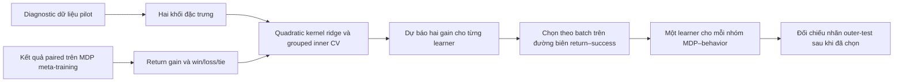

# OEH — phân tích method và lý do lựa chọn

Tên công khai của hệ thống cuối cùng là **OEH**. Các mã phiên bản trong thư mục,
manifest và source snapshot chỉ là định danh lịch sử để kiểm chứng bằng chứng.
Tài liệu này mô tả implementation hiện có, không đề xuất vòng tuning hoặc thay
đổi kết quả đã niêm phong.

## 1. Bài toán và bản chất của đóng góp

OEH (Offline Effective Horizon) bắt đầu từ câu hỏi đo độ khó học offline
trên MDP stochastic bằng pilot log: cần bao nhiêu dữ liệu để một learner đạt
mục tiêu return? OEH-v3 tạo requirement proxy trên action support quan sát.
Package cuối dùng các diagnostic đó như đặc trưng cho bước quyết định sau.

OEH là bộ chọn learner cho **offline RL tabular**, được học bằng meta-learning
có giám sát trên nhiều MDP. Với một nhóm MDP–behavior, hệ thống dùng diagnostic
từ dữ liệu pilot để dự báo lợi ích của các learner, sau đó chọn **một learner**
cho cả nhóm. Thư viện E1 gồm CFQI, IQL, BC, BCQ, CQL, Pi-b SPIBB và VI-LCB.
Hệ thống không trộn action, Q-function hoặc policy của các learner.

Đóng góp nằm ở cách liên kết điều kiện dữ liệu, dự báo lợi ích tương đối trên
hai endpoint, và quyết định chọn learner theo batch. Các đại lượng effective
horizon, risk và support là covariate của bộ chọn; implementation cuối cùng
không biến chúng thành chứng chỉ sample complexity hoặc bảo đảm policy an toàn.

[Offline Policy Selection under Uncertainty](https://proceedings.mlr.press/v151/yang22a.html)
cho thấy chọn policy dưới bất định là một bài toán nghiên cứu đã có. OEH dùng
nhãn kết quả trên các MDP meta-training và hồi quy diagnostic; nó không thực
hiện Bayesian off-policy evaluation như công trình đó. Vì vậy cần định vị
OEH là một thiết kế bộ chọn có mục tiêu cụ thể, không tuyên bố là thuật toán
đầu tiên chọn policy hoặc thay thế mọi phương pháp offline RL.

Trong mỗi outer fold, nhãn của chính fold đó không đi vào fit, chuẩn hóa hoặc
chọn ridge. Việc scoring dùng nhãn outer-test sau khi quyết định đã được tạo.
CLI hiện tại thực hiện cross-fitting trên một thư viện đã có nhãn; nó chưa
cung cấp một router pretrained được xác nhận độc lập cho task mới.

## 2. Vì sao cần đồng thời return và success

Với nhóm `g`, learner `a` và training seed `k`, normalized return được định nghĩa:

\[
r_{gak}=\frac{J(\pi_{gak})-J(\pi_{\mathrm{random}})}
{J(\pi^*)-J(\pi_{\mathrm{random}})},\qquad
s_{gak}=\mathbf{1}\{r_{gak}\geq0.95\}.
\]

Return không bị clip vào [0,1]. Success rate là tỷ lệ training seed đạt ngưỡng
0,95, **không phải tỷ lệ hoàn thành episode**. Các seed E1 chỉ định các stream
thu thập dữ liệu training khác nhau và có thể cả RNG của learner; không thể
diễn giải toàn bộ biến thiên là ngẫu nhiên của optimizer. Hai learner được
đối chiếu trên cùng MDP, behavior, seed và training buffer.

Một learner có thể tăng return trung bình nhờ cải thiện nhiều kết quả dưới
ngưỡng mà không tăng success. Ngược lại, đẩy vài kết quả qua ngưỡng có thể tăng
success trong khi kéo giảm return ở các seed khác. Mô hình riêng cho hai
endpoint giải quyết đúng sự khác nhau này. Ngưỡng 0,95 là quy ước cố định của
protocol, không phải hằng số phổ quát của offline RL.

Chọn CFQI làm mốc `C`, target của mỗi alternative là:

\[
\Delta R_{ga}=\frac1{10}\sum_k(r_{gak}-r_{gCk}),\qquad
\Delta S_{ga}=p_{ga}^{W}-p_{ga}^{L}.
\]

Ở đây `W` là alternative thành công và CFQI thất bại; `L` là trường hợp ngược
lại; `T` là cùng trạng thái success. Tần suất `W/L/T` được tính từ 10 cặp seed.
Đẳng thức `ΔS = pW − pL` là chính xác trên các nhãn paired, không phải heuristic.

**Lý do học gain tương đối:** câu hỏi chọn learner là “đổi khỏi mốc có lợi
không?”. Target paired loại mức khó chung của task ra khỏi hiệu quả tương đối.
Lợi ích giảm phương sai phụ thuộc tương quan giữa kết quả hai learner:
`Var(A−C) = Var(A)+Var(C)−2Cov(A,C)`; nó không được bảo đảm cho mọi dữ liệu.

**Lý do chọn CFQI:** trong E1, CFQI là learner cố định có return trung bình
cao nhất. Implementation của nó là fitted Q iteration bảo thủ theo support:
chỉ bootstrap qua action có quan sát, đặt Q của action không hỗ trợ bằng 0 và
dùng fallback đã khai báo. Tính bảo thủ phù hợp làm mốc trong bộ tabular này.
CFQI không phải CQL và không được chứng minh là mốc tốt nhất trên mọi cohort.
Việc chọn mốc này cũng là một lựa chọn kiến trúc phải công khai.

## 3. Đặc trưng biểu diễn điều gì

Định nghĩa tọa độ được giữ nguyên trong
[feature contract T1](../../artifacts/provenance/sources/docs/protocol/WEEK6_T1_STATISTICAL_FREEZE_v1.1.0.json).

| Khối | Số chiều | Thông tin |
|---|---:|---|
| Diagnostic dữ liệu B2 | 18 | Ngân sách, coverage state/action, visitation, thống kê trajectory, transition entropy, low-count cells và bootstrap uncertainty |
| B2 + diagnostic OEH3 | 22 | Thêm requirement proxy, selected-QVI fraction, risk và policy instability |
| Khối trên + diagnostic learner-conditional LC4 | 30 | Thêm censoring, contraction, pessimistic return, return SE, support và trajectory independence |

Transition stochasticity, behavior stochasticity và coverage là những yếu tố
khác nhau. Nhiều action xuất hiện không chứng minh transition khó; transition
entropy cao cũng không chứng minh dữ liệu phủ đủ các action cần thiết. Nhóm
đặc trưng này có lý do cơ chế vì sai số học policy phụ thuộc tương tác giữa
chúng. Entropy ở cell ít mẫu vẫn có thể ước lượng lệch; proxy count/uncertainty
cung cấp ngữ cảnh, không khắc phục hoàn toàn vấn đề nhận dạng.

Đối với IQL và BC, input là `[φ_CFQI, φ_a−φ_CFQI]`: tương ứng **44 hoặc 60
chiều**. Diagnostic chung không tạo khác biệt giữa learner; các tọa độ delta
đó bằng 0 trong dữ liệu E1. Phần learner-conditional mới bổ sung khác biệt có
thông tin. Không nên gọi mọi tọa độ của cả hai khối là learner-specific.

Đối với bốn learner bổ sung, E1 không có pilot diagnostic riêng tương ứng.
OEH ghép diagnostic của ba anchor CFQI/IQL/BC, thành **66 hoặc 90 chiều**, rồi
học một head riêng cho mỗi alternative. Cách này dùng được bằng chứng pilot
đã có và tránh tạo diagnostic từ nhãn outer-test. Nó có giới hạn: các tọa độ
chung lặp lại, và head không quan sát trực tiếp diagnostic đặc thù của BCQ,
CQL, Pi-b SPIBB hoặc VI-LCB. Lặp tọa độ còn thay đổi hình học của kernel;
chưa có ablation chứng minh biểu diễn này là tối ưu.

MDP ID, tên family và outcome outer-test không được dùng như tọa độ dự báo.
ID dùng để join và giữ các behavior cùng MDP trong một fold. Diagnostic pilot
được tạo trước outcome training; tuy nhiên “không đọc nhãn query khi fit” khác
với “kiến trúc chưa từng được lựa chọn sau khi xem E1”.

## 4. Vì sao dùng quadratic kernel và dự báo xác suất paired

Sau khi chuẩn hóa bằng **training rows**, forecaster dùng:

\[
K(z,z')=\left(1+\frac{z^\top z'}d\right)^2.
\]

Kernel bậc hai biểu diễn hằng số, tác động bậc một, bình phương và các tương
tác đôi. Ví dụ cơ chế coverage × transition entropy có thể được học mà không
viết rule theo từng family. Giữ bậc hai hạn chế một phần độ phức tạp và tránh
thêm kiến trúc neural cần thiết kế khác; đó là lý do thiết kế, không phải bằng
chứng kernel luôn tốt hơn neural hoặc linear.

Không gian polynomial đầy đủ có `binom(d+2,2)` tọa độ: 1.035 khi `d=44`, đến
4.186 khi `d=90`. Số group training trong một primary outer fold chỉ khoảng
330–340; vì vậy quadratic vẫn có khả năng overfit. Ridge và đánh giá theo
MDP là thành phần cần thiết, không phải chi tiết tùy chọn.

Weighted centering giữ intercept không bị phạt. Một phép phân rã trị riêng
phục vụ nhiều target và mọi ridge; bootstrap dùng multiplicity của toàn MDP.
Chuẩn hóa được fit lại bên trong từng inner fold, tránh dùng thống kê query
để biến đổi training.

Ridge được chọn bằng **4-fold grouped inner CV** từ grid gốc
`[0.0001, 0.001, 0.01, 0.1, 1, 10, 100]`. Head return dùng MSE; head success
dùng squared loss trên tần suất `W/L/T`, sau phép chiếu lên simplex. Nếu loss
bằng nhau, chọn ridge lớn hơn. Tất cả behavior và bootstrap copy của một MDP
được giữ cùng fold; 5 outer folds giữ nguyên phân chia E1.

Squared frequency loss có lý do xác suất cụ thể. Với dự báo `p` và tần suất
paired `q`, Brier score trung bình trên nhãn seed bằng
`||p−q||² + 1−||q||²`; hạng cuối không phụ thuộc dự báo. Vì vậy tiêu chí dùng
trong code tương đương chọn theo Brier trên các seed, trong trọng số hiện có.
Các proper scoring rules được thảo luận tại
[JMLR: From Classification Accuracy to Proper Scoring Rules](https://jmlr.org/papers/v24/23-0106.html).
Phép chiếu simplex chỉ bảo đảm vector không âm và tổng bằng 1; nó **không**
chứng minh xác suất được calibrated hoặc là posterior Bayesian. Với 10 seed,
tần suất quan sát chỉ có độ phân giải 0,1.

Dự báo từ hai feature blocks được lấy trung bình với trọng số 1/2–1/2.
Trọng số bằng nhau tránh thêm một vòng học trọng số. Hai khối chứa nhiều
tọa độ chung nên có tương quan; không thể mặc định ensemble luôn giảm
phương sai hoặc là cách phối hợp tốt nhất. Chưa có ablation giữ các yếu tố
còn lại cố định để định lượng riêng đóng góp của kernel, simplex hay ensemble.

## 5. Router chọn learner như thế nào

Với toàn bộ batch outer-test `G`, code xét các phương án:

\[
a_g(\lambda)=\arg\max_a\{\widehat{\Delta R}_{ga}
+\lambda\widehat{\Delta S}_{ga}\},\quad\lambda\geq0,
\]

\[
R(\lambda)=\sum_gw_g\widehat{\Delta R}_{g,a_g(\lambda)},\quad
S(\lambda)=\sum_gw_g\widehat{\Delta S}_{g,a_g(\lambda)}.
\]

Code xét `λ=0` và các giao điểm dương giữa utility của từng cặp learner.
Tại hòa utility, ưu tiên predicted success cao hơn, sau đó thứ tự registry.
Trong các phương án đã xét có `R>0` và `S>0`, chọn phương án làm lớn nhất
`R×S`. Nếu không có, toàn bộ batch quay về CFQI. `λ` được quyết định từ
dự báo, không đọc realized outcome outer-test.

**Lý do chọn tích gain:** buộc cả hai gain dự báo tổng hợp cùng dương, tránh
chấp nhận gain return lớn để bù một success gain âm. Trong số học chính xác,
đổi đơn vị dương của mỗi endpoint chỉ nhân tích bởi một hằng số và đổi thang
`λ`; tập utility-frontier không đổi. Đây là một tính chất về đơn vị, không
phải chứng minh objective đó tối ưu về mặt khoa học hay không có lựa chọn
thiết kế. Tie rule, library, feature blocks và kernel vẫn là những lựa chọn.

**Ba giới hạn phải nói rõ:**

1. Gain dương là dự báo tổng hợp. Một group/MDP vẫn có thể bị giảm return,
   và toàn batch vẫn có thể kém CFQI nếu mô hình sai. Fallback không tạo
   bảo đảm no-harm hay lower-confidence safety certificate.
2. Một `λ` chung được chọn theo batch. Thay đổi các query group khác có thể
   thay đổi route của cùng một group. OEH là **batch/transductive routing**;
   không phải rule độc lập chỉ phụ thuộc một task.
3. Tìm tốt nhất trong các route đã xét không đồng nghĩa tối ưu toàn bộ
   tổ hợp deterministic của mọi group.

Giới hạn thứ ba có phản ví dụ thuần toán học, không phải một bộ MDP mới.
Hai group có cùng hai alternative `A/B`: gain của A là `(0,3; 0,1)`, của B
là `(0,1; 0,3)`; CFQI là `(0;0)`. Một trọng số chung và tie rule cho cả hai
group chỉ cho route `A/A` hoặc `B/B`, mỗi route có tích tổng gain `0,12`.
Route `A/B` có tổng `(0,4;0,4)`, tích `0,16`, nhưng không được chọn. Do đó
paper phải mô tả đúng thuật toán quét utility frontier, không ghi “global
optimal deterministic multi-objective selection”.

Trong E1, mỗi MDP có đúng 5 behavior nên trọng số group và trung bình theo
MDP tương thích. Loader tổng quát chấp nhận số behavior không đều, nhưng
router dùng trọng số trên group còn scorer lấy trung bình behavior rồi MDP.
Nếu số behavior khác nhau, hai trọng số này không còn tương đương. Phạm vi
đã kiểm chứng là thiết kế cân bằng E1; tài liệu này không thay đổi math để
mở rộng phạm vi đó.

## 6. Bằng chứng cho lợi ích quan sát được

Nguồn trực tiếp là [group metrics](../../artifacts/week7/oeh_v5_e1_reuse_r44_2026-09-29/group_metrics.csv),
[seed outcomes](../../artifacts/week7/oeh_v5_e1_reuse_r44_2026-09-29/selected_seed_outcomes.csv)
và [mechanism audit](../../artifacts/week7/oeh_v5_e1_reuse_r44_2026-09-29/mechanism_audit.json).
Primary gồm 84 stochastic MDP, 420 group, 4.200 outcome seed tại x10.

| Method | Mean normalized return | Success rate |
|---|---:|---:|
| OEH | 0,806803 | 45,7619% |
| CFQI | 0,783373 | 41,1905% |
| OEH-v4E, comparator lịch sử | 0,788130 | 37,7619% |
| Bản tham chiếu lưu trữ | 0,793480 | 43,3333% |

OEH tăng `0,023429` return và `4,5714` điểm phần trăm success so với CFQI;
tăng `0,018672` và `8,0000` điểm so với comparator OEH-v4E. Thành công mới
và mất thành công **đều** được tính: so với CFQI có 308 seed thắng và 116
seed thua, net +192/4.200; so với OEH-v4E là 379 thắng, 43 thua.

Phân rã dưới đây lấy tổng gain của các group chọn từng learner, chia **420**.
Các cột gain vì vậy là đóng góp vào mean toàn primary, không phải mean chỉ
trên group được chọn.

| Learner được chọn | Số group | Đóng góp return vs CFQI | Đóng góp success vs CFQI (pp) | Đóng góp return vs bản tham chiếu |
|---|---:|---:|---:|---:|
| CFQI | 291 | 0 | 0 | −0,000061 |
| BCQ | 59 | +0,009919 | +1,9286 | +0,005277 |
| CQL | 48 | +0,009799 | +2,4048 | +0,005224 |
| IQL | 15 | +0,000817 | +0,2143 | +0,000003 |
| VI-LCB | 5 | +0,002866 | 0 | +0,002866 |
| Pi-b SPIBB | 2 | +0,000029 | +0,0238 | +0,000012 |
| BC | 0 | 0 | 0 | 0 |

CFQI giữ 69,29% route. BCQ/CQL chỉ chiếm 25,48% group nhưng đóng góp khoảng
**78,83% phần tăng return so với bản tham chiếu**. Điều này phù hợp với cơ chế
khai thác tính bổ sung giữa learner: một learner có mean thấp nếu chạy trên
mọi task vẫn có thể tốt ở một phần task được chọn. Nó không chứng minh quan
hệ nhân quả của từng thành phần kiến trúc; thay thư viện và rule cùng lúc
không phải controlled ablation. BC không được chọn ở E1 cũng không chứng
minh BC vô ích với mọi distribution.

So với CFQI, return giảm trên **9/84 MDP**, success giảm trên **11/84 MDP**.
So với bản tham chiếu, các số là 7 và 11. Không thể chuyển kết quả tăng trung
bình thành tuyên bố vượt hoàn toàn trên từng môi trường. Cả 180 control group
đều chọn CFQI; các control được fit riêng, nên kết quả đó không phải phép
kiểm tra transfer từ stochastic sang deterministic.

Tổng hợp đủ 120 MDP cho OEH `0,693242` return và `45,60%` success; đây là
pooled descriptive statistic. Không nên trộn primary 84 MDP và control 36
MDP để trình bày một endpoint confirmatory mới.

## 7. Khái quát: điều gì đã có và điều gì chưa được chứng minh

**Khái quát ở cấu trúc:** không có rule viết riêng theo MDP ID/family; mọi
alternative dùng cùng target paired, forecaster và procedure inner CV.
Quadratic interactions được học thay vì gán ngưỡng entropy/coverage riêng
cho từng family. Có thể đăng ký alternative khác nếu có đủ nhãn paired và
diagnostic anchor hợp lệ, nhưng capability của schema không chứng minh
generalization thực nghiệm đến library hoặc distribution mới.

**Khái quát của phép kiểm tra trong một lần fit:** giữ toàn MDP ngoài outer
fit ngăn các behavior gần nhau rò rỉ nhãn giữa training/test. Chọn ridge bên
trong training là học mô hình hợp lệ; tự nó không phải tuning bằng query
outcome. Kiến trúc, target, mốc CFQI và library vẫn được chọn trong quá trình
nghiên cứu, nên không thể mô tả hệ thống là hoàn toàn không phụ thuộc data.

**Giới hạn của bằng chứng nghiên cứu:** bản cuối được chọn sau nhiều lần
phân tích E1. Nested CV của mỗi lần fit không xóa lịch sử quyết định thích
nghi trên cùng cohort. Vấn đề selection bias được phân tích trong
[Cawley & Talbot, 2010](https://jmlr.csail.mit.edu/beta/papers/v11/cawley10a.html);
giới hạn của adaptive holdout reuse được trình bày trong
[Dwork et al., 2015](https://proceedings.neurips.cc/paper/2015/hash/bad5f33780c42f2588878a9d07405083-Abstract.html).
OEH không triển khai cơ chế reusable holdout của công trình sau.

2.000 bootstrap refit lấy toàn MDP theo strata giữ phụ thuộc giữa behavior
và seed, và refit các comparator cùng draw. Sáu basic one-sided 95% lower
bounds đều dương trong record, nhưng là **diagnostic sau adaptive reuse**.
Chúng không bao gồm toàn bộ quá trình tìm kiến trúc trước đó, không phải
simultaneous 95% guarantee cho sáu contrast và không xác nhận independent
confirmation. Verdict NO_GO ban đầu của OEH-v4E và kết quả âm vẫn giữ nguyên.

**Giới hạn chi phí và triển khai:** bộ chọn cần kết quả learner có nhãn trên
nhiều MDP để meta-train và cần diagnostic pilot của ba anchor. Routing trên
CPU rẻ hơn bootstrap hàng nghìn lần, nhưng runtime bootstrap đã lưu không
phải tổng training cost và không chứng minh end-to-end compute saving.
[Tang & Wiens, 2021](https://proceedings.mlr.press/v149/tang21a.html) cũng xem
chi phí đánh giá/chọn mô hình là một practical consideration trong offline
RL; công trình đó không cung cấp chứng nhận hiệu quả cho OEH.

Phạm vi kiểm chứng hiện tại: tabular, library bảy learner E1, x10, γ=0,95,
horizon=100, 10 seed, năm behavior/MDP và feature contract đã khai báo. Chưa
có bằng chứng độc lập cho deep RL, continuous control, thay budget, thay
success threshold, OOD cohort hoặc inference pointwise ngoài batch.

## 8. Cách trình bày trong paper/thesis

Mô tả method có thể dùng: **OEH dự báo paired return gain và paired success
gain từ diagnostic dữ liệu offline, dùng grouped nested cross-fitting và
chọn learner trên utility frontier của một batch, với CFQI làm mốc.**

Kết quả có thể dùng: **Trên cohort stochastic E1 được tái sử dụng để phát
triển, OEH có mean return và success rate cao hơn CFQI và comparator lịch
sử; lợi ích quan sát chủ yếu gắn với việc chọn BCQ/CQL ở một số group, trong
khi giữ CFQI ở phần lớn group.** Phải kèm scope post-hoc và kết quả âm.

Không nên dùng các claim: “bảo đảm vượt CFQI”, “không còn kết quả âm”,
“calibrated safe policy improvement”, “global optimal router”, “đã chứng
minh generalization phổ quát”, hoặc “đã xác nhận độc lập trên E1”. Tên OEH
cuối cùng thống nhất phương pháp công khai; nó không thay đổi giá trị chứng
cứ của các lần nghiên cứu trước.

Vị trí đóng góp phù hợp là kết hợp diagnostic có ý nghĩa trong stochastic
tabular với mục tiêu paired hai endpoint và một rule batch minh bạch, có
artifact truy xuất được. Độ mới so với toàn bộ literature và đóng góp riêng
của từng thành phần chưa được thiết lập bằng tài liệu hiện có; cần phân
biệt điều này với tính đúng đắn của phép kiểm chứng implementation.

## 9. Đối chiếu implementation

- [core.py](core.py): `paired_targets`, `kernel_predictions`, `forecast_block`,
  `simplex`, `joint_routes` và các core head.
- [router.py](router.py): các head mở rộng, route cuối và scoring theo MDP.
- [numerics.py](numerics.py): chuẩn hóa và phân fold whole-MDP.
- [data.py](data.py): feature/seed/threshold/fold contracts.
- [evidence.py](evidence.py): hash, scientific AST, full grid và bootstrap audit.
- [README sử dụng](README.md) và [bảng kết quả](../../artifacts/README.md).

Các số phân rã là phép cộng lại CSV nguyên trạng, không sinh MDP, train policy,
thay quyết định hoặc thực hiện một vòng chọn phiên bản mới. Đổi tên public
package/CLI và label của bản sao figure không thay đổi forecasting/routing.
