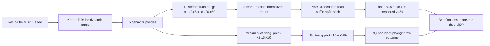

# DATA — tuần 8: data dictionary và benchmark audit

**Chốt audit: 11/10/2026.** Bộ 120 MDP là dữ liệu **nhóm tự sinh** để kiểm định trong-họ, không phải benchmark ngoài. Benchmark công bố duy nhất đã thực chạy là Farama Minari FourRooms; nó chỉ kiểm tra một thành phần và có verdict **NO-GO**. Các con số dưới đây lấy từ protocol/manifest kết quả đã niêm phong và được kiểm lại bằng `python scripts/analysis/audit_week8_data.py --strict-available`.

## Dữ liệu sinh như thế nào và vì sao phải tự sinh

Không có dataset công bố nào trong rà soát cung cấp đồng thời: nhiều MDP hữu hạn độc lập, nhiều behavior trên cùng MDP, các prefix ngân sách lồng nhau, mười lần train/learner/budget, và kernel thật để tính nhãn normalized return chính xác. Vì vậy nhóm tự sinh cohort kiểm định để cô lập ảnh hưởng của họ MDP, behavior, budget và learner; đây là **benchmark nội bộ có kiểm soát**, không được gọi là benchmark ngoài.

| Thành phần | Giá trị đã đối chiếu | Nguồn chuẩn |
|---|---:|---|
| Cohort | 120 kernel: 84 stochastic chính, 36 deterministic control | `protocol.json`, `actual_kernel_audit_preoutcome.json` |
| Họ MDP | uniform Garnet 30; forward-layered 36; bottleneck 18; lock-structured 36 | `family_counts`; lock là control |
| Kích thước | $|S||A|$: Garnet 48–256; layered 32–160; bottleneck 40–192; lock 16–38 | suy ngược đúng từ `log_state_action_count` |
| Behavior | 5: perturbed reward, Q-star softmax, shifted dynamics, structured random, two-policy mixture | `labels.csv`; 120×5×3 = 1.800 hàng nhãn |
| MDP/evaluation | $\gamma=0{,}95$, horizon sinh log 100 | paper §3; lời gọi generator trong `run_oeh_final_120.py` |
| Pilot/prefix | query chính x10 = $10|S||A|$ transition; bundle còn prefix x2, x5; namespace pilot tách train | protocol `pilot_multipliers`; paper §3 |
| Outcome grid | x1, x2, x5, x10, x20, x50; BC/CFQI/IQL; seed train 0…9 | 120×5×3×6×10 = **108.000** job |
| Nhãn | $NR=(J-J_{random})/(J^*-J_{random})$; seed đạt nếu $NR\ge0{,}95$; lớp đầu tiên mà ≥8/10 seed đạt ở **mọi** budget từ đó trở lên; lớp 6 = censored >x50 | `labels.csv`, `all_core_budget_seed_outcomes.csv` |
| Sinh vật lý | 6.600 buffer theo manifest đã seal; ba kernel bottleneck được generator đổi seed do lọc dynamic range trước outcome | `dataset_seal.json`, kernel audit |
| Hash chính | protocol `c7d6…a18`; manifest dataset `a4ff…426`; plan `7111…cfe`; pre-outcome seal `f83a…ea4` | `protocol.sha256`, `dataset_seal.json`, `result_manifest.json` |

### Data dictionary tối thiểu

| Bảng/đơn vị | Khóa | Trường dùng trong phân tích | Quyền truy cập |
|---|---|---|---|
| Buffer trajectory / một MDP–behavior–stream | `instance_id`, `policy_family`, stream seed, prefix | `(s,a,r,s',terminated)` và metadata $|S|,|A|$; file/hash nằm trong manifest | raw local; riêng E1 có archive Git LFS |
| `pilot_features.csv` / MDP–behavior–learner | `mdp_id, policy_family, algorithm` | 30 diagnostic pilot: coverage, entropy, return, OEH3/LC4; đầu vào dự báo, không chứa outcome test | Git/public |
| `all_core_budget_seed_outcomes.csv` / job | khóa trên + `budget,training_seed` | `normalized_return,success,runtime_seconds` | Git/public |
| `labels.csv` / MDP–behavior–learner | khóa ba cột | `event`, `successes_x1…x50`, `panel` | Git/public |
| `predictions_preoutcome.csv` / phương pháp | khóa nhãn + `method` | `p_0…p_6`; đã seal trước learner outcome | Git/public |
| `result_manifest.json` / run | protocol/preoutcome/plan hashes | số job, số MDP, verdict và hash output | Git/public |

Clone có Git LFS tải đúng hash của **61/61** file mà `audit_week8_data.py --strict-available` kiểm tra, gồm nguồn lịch sử và nhãn cohort `third120` trước đây bị lược. Hai target của dataset seal cohort 7 (`manifest.json`, `data_only_index.json`) được lưu bằng Git LFS; cần `git lfs pull` trước khi dùng chúng. Các feature A2 đã tính của sáu cohort huấn luyện và OEH-B của cohort 4/7 được lưu để refit và đối chiếu dự báo. Raw E1 có [archive Git LFS](../../datasets/archives/README.md), phải giải nén trước khi tái sinh feature E1; raw buffer của các cohort khác vẫn chỉ lưu cục bộ, nên clone công khai **chưa đủ để tái sinh end-to-end** mọi thí nghiệm hoặc kiểm hash từng buffer của tất cả cohort. Repo cũng chưa có `LICENSE` ở root: “Git/public” trong bảng chỉ có nghĩa là đọc được artifact, **không** mặc nhiên cấp quyền tái phân phối dữ liệu tự sinh.

## Phân bố censored và leakage checklist

Lớp 0…6 có số hàng: **120, 73, 71, 71, 69, 99, 1.297**; censored toàn bộ là **72,06%**. Panel stochastic chính censored **900/1.260 = 71,43%**; control **397/540 = 73,52%**. Trong panel chính: BC **381/420 = 90,71%**, CFQI **193/420 = 45,95%**, IQL **326/420 = 77,62%**. Theo behavior: perturbed reward 73,41%; Q-star softmax 41,27%; shifted dynamics 69,05%; structured random 84,92%; mixture 88,49%.

| Kiểm leakage/audit | Kết quả |
|---|---|
| 108.000 khóa job duy nhất; `success == (NR≥0,95)`; counts và công thức 1.800 nhãn | **PASS**, 0 mismatch |
| 120 fingerprint nội bộ duy nhất và không giao các cohort đã mở | **PASS theo pre-outcome audit**; 3 seed resolved được ghi trước outcome |
| Pilot stream và outcome-training stream không trùng | **PASS theo thiết kế namespace/seal**; chưa thể kiểm byte-level vì raw manifest bị lược |
| Meta-training–test không trùng kernel | **PASS theo fingerprint audit**; trùng tên text với cohort 4 đã được prefix/correct trước outcome |
| Dự báo/choice trước outcome | **PASS**: seal ghi `learner_outcomes_observed: 0` |
| Split/uncertainty | **PASS**: resample và fold theo MDP, không coi 5 behavior × 10 seed là độc lập |
| Mạch bài viết | **CẦN SỬA**: paper §3 nói OOF trên “six opened cohorts”, trong khi protocol và paper §5 nói **seven**; protocol là nguồn chuẩn |
| Duyệt nhóm | **PENDING**: Linh—mạch bài toán; Hưng—giả định; Quốc Việt—công thức nhãn |

## Sàng lọc benchmark offline đã công bố

Tiêu chí bắt buộc: task/MDP độc lập với generator nhóm; Markov/tabular hoặc ánh xạ đóng băng hợp lệ; cắt được pilot và nhiều budget không dùng test; có reward/return và môi trường/ground truth đánh giá; giấy phép và version rõ.

| Benchmark (version/link) | Audit nhanh | License | Verdict cho claim đầy đủ |
|---|---|---|---|
| [Minari D4RL FourRooms-random-v0](https://minari.farama.org/datasets/D4RL/minigrid/fourrooms-random-v0/) (Minari 0.4.3; 10.174 episode, 1.000.070 step) | Ngoài nhóm, action rời rạc, env phục hồi được; observation 7×7 là cục bộ nên không Markov/tabular nếu chưa chứng minh abstraction. Đã chia 990 train/2.084 test/7.100 bỏ, hash HDF5 `579a…bf3`. Component gate đã chạy **NO-GO**. | [D4RL dataset CC BY 4.0](https://github.com/Farama-Foundation/D4RL#licenses); [generation scripts MIT](https://github.com/Farama-Foundation/minari-dataset-generation-scripts) | **NO-GO** full OEH; **FEASIBLE** chỉ cho component stress test đã báo âm |
| [Minari D4RL FourRooms-v0](https://minari.farama.org/datasets/D4RL/minigrid/fourrooms-v0/) (Minari 0.4.3; 590 episode, 10.010 step) | Cùng một MDP FourRooms, expert behavior duy nhất, quá nhỏ cho lưới prefix×budget×10 seed và không bổ sung MDP độc lập | như trên | **NO-GO** standalone; có thể làm reference behavior, không được tính là MDP mới |
| [RL Unplugged bsuite](https://github.com/google-deepmind/deepmind-research/tree/master/rl_unplugged) ([NeurIPS 2020](https://proceedings.neurips.cc/paper/2020/hash/51200d29d1fc15f5a71c1dab4bb54f7c-Abstract.html)) | Ba task cartpole/catch/mountain-car × action-noise {0,…,0.5}; nhẹ và có return, nhưng observation không đồng nhất tabular, cần adapter/state abstraction đóng băng; chưa thấy điều khoản dataset riêng đủ rõ ngoài license code | [code repo Apache-2.0](https://github.com/google-deepmind/deepmind-research/blob/master/LICENSE); **cần xác nhận license dữ liệu GCS** | **NO-GO hiện tại**; nâng thành FEASIBLE sau license + manifest/hash + adapter + pilot/budget protocol |
| [Minari D4RL PointMaze umaze-v2](https://minari.farama.org/datasets/D4RL/pointmaze/umaze-v2/) (Minari 0.4.3; 13.210 episode, 1M step) | Môi trường/return phục hồi được nhưng state và action liên tục; behavior còn phụ thuộc waypoint memory (không Markov theo observation hiện tại). Discretization sẽ đổi estimand | [D4RL dataset CC BY 4.0](https://github.com/Farama-Foundation/D4RL#licenses); [generation scripts MIT](https://github.com/Farama-Foundation/minari-dataset-generation-scripts) | **NO-GO** cho claim tabular hiện tại |

Kết luận benchmark: giữ FourRooms-random đúng tên **published-data component stress test (NO-GO)**; không dùng cohort 120 tự sinh để thay thế rồi gọi là benchmark ngoài. Ứng viên đáng điều tra tiếp là RL Unplugged bsuite, nhưng chỉ sau khi khóa giấy phép dữ liệu, state mapping, episode split, prefix budgets, return normalization và SHA-256 trước khi xem outcome.
