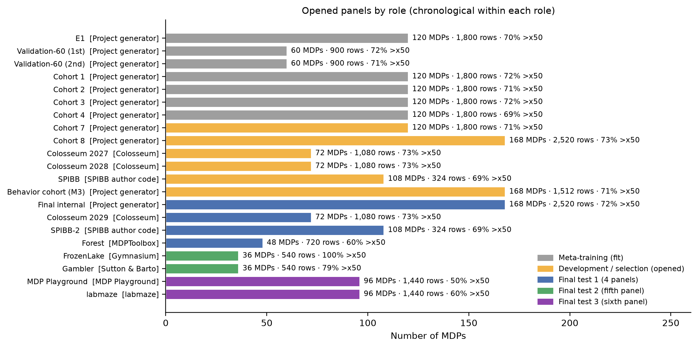
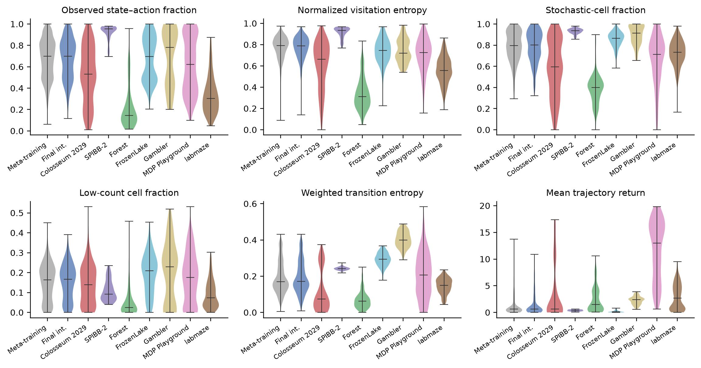
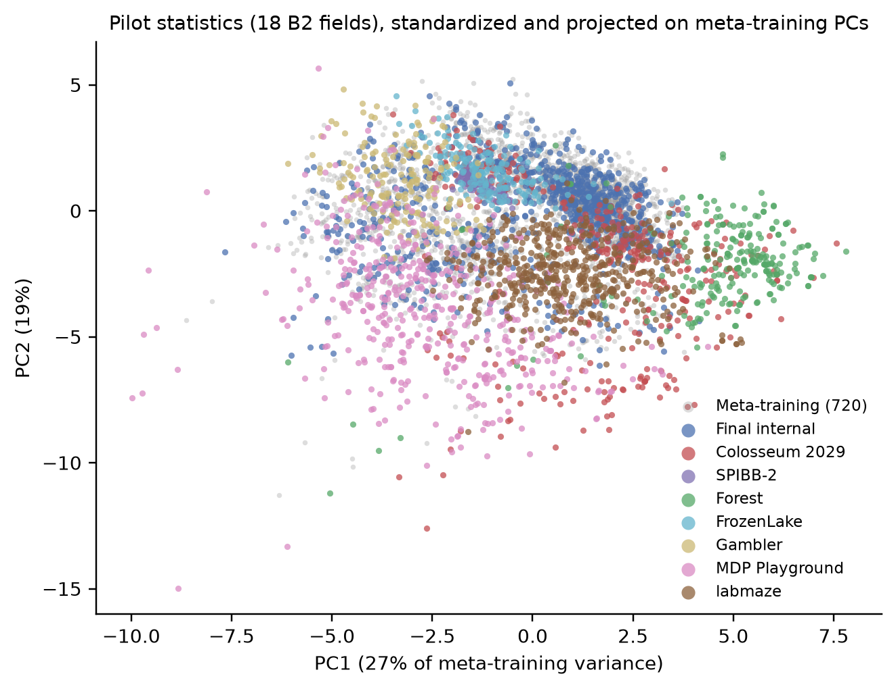
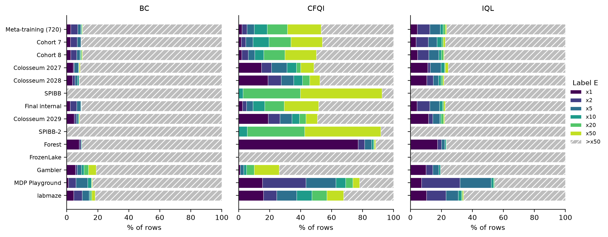
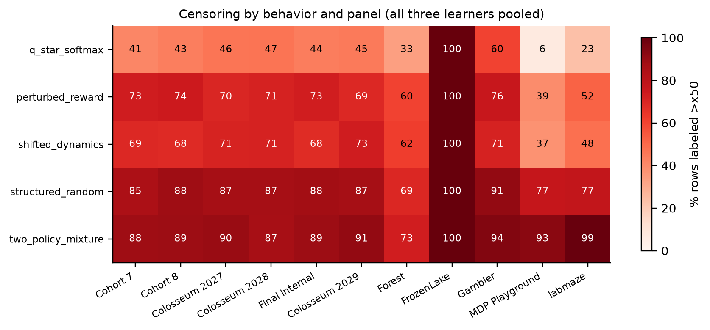
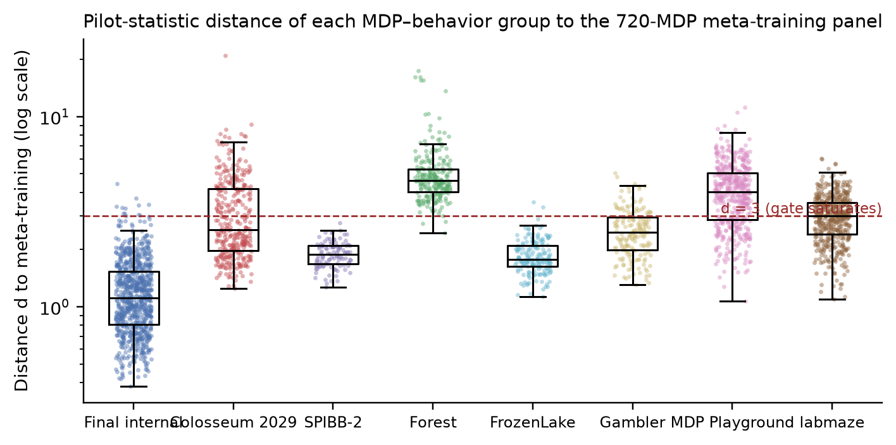
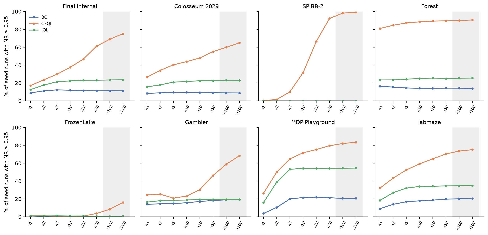

# 3. Dataset and Data Generation

This chapter describes the data on which every forecast and every label of the thesis is computed: which units are measured, how the Markov decision processes (MDPs) and logs are generated or adapted, how the requirement labels are produced, how the panels are assigned to fitting, selection and testing, and what the resulting data look like. The definitions of the target are given in Chapter 2 and are only applied here. The forecaster and its components are described in Chapter 4.

## 3.1. Data Requirements and Why the Dataset Is Generated

### 3.1.1. What is needed to measure the requirement of one learner

The empirical requirement $E$ of Chapter 2 is the first budget, on a fixed grid, from which a learner trained on independent data succeeds in at least eight of ten seeds at that budget and at every larger budget. To label a single row, that is one MDP, one behavior policy and one learner, the study therefore needs:

- an **independent pilot** collected by the behavior policy, which is the only input of the forecaster;
- **ten independent training streams** from the same MDP and behavior, each long enough for the largest budget, and the **nested prefixes** of every stream at each budget;
- a **trained policy** for every learner, budget and seed;
- the **exact value** of every trained policy, and the exact optimal and uniform-random returns of the MDP, so that normalized return and success are computed without evaluation noise.

### 3.1.2. Why many MDPs, behaviors, budgets and seeds

One labeled row is not enough to evaluate a forecaster. Forecasting scores are averaged within an MDP and then across MDPs, and all statistical inference treats the MDP as the independent unit (Section 4.12). Differences between two forecasters can only be attributed to the method if they hold over many independent MDPs, behaviors that produce different coverage, and learners with different mechanisms. A separate population of MDPs with known labels is also needed to fit the forecaster (meta-training), and further populations are needed to select between candidate configurations and to test the chosen one.

### 3.1.3. Controlled generation and published benchmarks

Published offline reinforcement learning datasets [@fu2020; @gulcehre2020] provide fixed logs, usually one log per task, recorded in large or continuous environments. They do not provide matched budgets, repeated independent training streams, or exact reference returns, so the requirement $E$ cannot be computed from them (Table 3.1). The study therefore generates its own data under a fixed collection protocol, on tabular MDPs whose kernels are known exactly. Two kinds of MDP sources are used:

- **the project generator**, four random tabular families used for meta-training, development and the internal test (Section 3.3);
- **independently designed MDP sources**, used to test transfer: the Colosseum benchmark [@conserva2022], the random MDPs and baseline policies of the SPIBB benchmark [@laroche2019], the forest-management problem of MDPToolbox [@chades2014], Gymnasium FrozenLake [@towers2024], the gambler's problem [@sutton2018], MDP Playground [@rajan2023] and labmaze layouts from DeepMind Lab [@beattie2016] (Section 3.5).

For the external sources the kernels, and for SPIBB also the behavior policy, are designed by other authors; the logs, training streams and labels are always generated by this study under the same protocol.

Table: Table 3.1. What is required to measure the empirical requirement, and what each type of data provides.
| Requirement | Published offline dataset | This study |
|---|---|---|
| Pilot that is independent of the training data | One log; a split is possible but not independent of the policy that produced it | Separate pilot stream with its own seed namespace |
| Several budgets of the same data source | Subsets of one log | Nested prefixes x1 … x50 (x200) of each stream |
| Ten independent training streams | No | Yes, disjoint seeds |
| Exact optimal and random return | Rarely; environments are usually not tabular | Yes; exact dynamic programming on the known kernel |
| Many independent MDPs | Few tasks | @@NUM:all_mdps_opened@@ opened MDPs (Table 3.8) |
| Known behavior policy | Sometimes | Yes (generated), or the benchmark authors' policy (SPIBB) |

## 3.2. Data Units and Data Dictionary

### 3.2.1. Transition, trajectory, stream and buffer

A **transition** is the tuple $(s,a,r,s')$ together with a trajectory identifier, the time step and the terminal and truncation flags. A **trajectory** starts from the initial distribution $\rho$ and ends at a terminal state or after at most 100 steps. A **stream** is a sequence of trajectories generated with one seed; a **buffer** is a prefix of a stream that contains exactly the number of transitions of one budget. Because the budgets are prefixes of the same stream, the buffer at $x10$ contains the buffer at $x5$, and so on (nested prefixes).

Budgets are expressed as multiples of the size of the state–action space. A budget of $xm$ means

$$ n(xm) = m\,|S|\,|A| $$ (3.1)

logged transitions **in total**. It does not mean $m$ transitions per state–action pair: the behavior policy decides which pairs are visited, and many pairs may not be visited at all. The pilot $D_0$ is the $x10$ prefix of the pilot stream.

### 3.2.2. MDP, group, row, job, cohort and panel

Figure 3.1 shows how the units are produced, and Table 3.2 lists them. The **MDP** is the unit of independence. An **MDP–behavior group** shares one pilot and one set of training streams. A **row** adds the learner and carries one label and one forecast per method. A **learner job** trains one learner on one buffer and evaluates the resulting policy. A **cohort** or **panel** is a set of MDPs generated under one frozen protocol; *cohort* is used for the project generator and *panel* for any registered set, including external sources.

{width=16}

Table: Table 3.2. Units of the data and their keys.
| Unit | Key | Count per parent | Role |
|---|---|---|---|
| MDP | `mdp_id` | — | Independent unit of inference; scores are averaged within it |
| MDP–behavior group | `mdp_id`, `policy_family` | 5 behaviors (1 for SPIBB) | One pilot $D_0$; ten training streams |
| Row | `mdp_id`, `policy_family`, `algorithm` | 3 learners (BC, CFQI, IQL) | One label $E$ and one seven-class forecast per method |
| Learner job | row, `budget`, `training_seed` | 6 budgets (8 in final panels) × 10 seeds | One trained policy and its exact normalized return |
| Cohort / panel | protocol namespace | 36–168 MDPs | Frozen protocol, seal and role (Table 3.8) |

### 3.2.3. Files and fields

Every panel is stored as the same set of files (Table 3.3). Files that contain outcomes are created only after the forecasts of that panel are sealed (Section 3.8).

Table: Table 3.3. Data dictionary of a panel. "Pre-outcome" files exist before any learner is trained on the panel.
| File | Created | Key fields |
|---|---|---|
| Kernel (`.npz`) and data manifest | Pre-outcome | $P(s'\mid s,a)$, $R(s,a)$, $\rho$ ($\gamma=0.95$ fixed); SHA-256 fingerprint |
| Buffers | Pre-outcome | state, action, reward, next state, trajectory id, time step, terminal, truncated; buffer SHA-256 |
| `pilot_features.csv` | Pre-outcome | 18 generic pilot statistics (B2) and the pilot diagnostics (D) of each row |
| `query_preoutcome.csv` | Pre-outcome | all 108 forecaster input fields, including posterior-simulation (OEH-B) and planning-risk (OEH-H) fields |
| `predictions_preoutcome.csv` | Pre-outcome, sealed | `method`, `distance` $d$, class probabilities `p_0` … `p_6` |
| `outcomes.csv` | After seal | `budget`, `training_seed`, `buffer_sha256`, `normalized_return`, `success` |
| `labels.csv` | After seal | `successes_x1` … `successes_x50` (… `x200`), `event` $E\in\{0,\dots,6\}$, `event_extended` |

## 3.3. MDP Families of the Project Generator

The project generator has four families. Three are stochastic and form the primary panel; the fourth is deterministic and serves as a control in the earlier cohorts. Figure 3.2 (a–d) shows their structure.

### 3.3.1. Uniform Garnet

Random MDPs in the style of Garnet generators [@archibald1995]. Every state–action pair moves to a small random set of successor states with Dirichlet-distributed probabilities, and rewards are sparse. Difficulty comes from stochastic branching and from having to find the few rewarding pairs.

### 3.3.2. Forward-layered

States are arranged in layers. Transitions move forward through the layers, mostly along a backbone, with random branching to neighboring states of the next layer. Rewards appear late, so a good policy has to plan several steps ahead, and errors made early cannot be corrected later in the episode.

### 3.3.3. Bottleneck

Two communities of states are connected by a narrow bridge. The rewarding states lie in the second community, and the bridge is taken with low probability by most policies. The pilot therefore often covers the first community well and the rewarding region poorly.

### 3.3.4. Combination lock (deterministic control)

A deterministic chain with two actions in which the wrong action resets to the start [@misra2020]. It is the classic hard-exploration structure and has no transition noise, so it isolates the effect of coverage from the effect of stochasticity. Control rows are kept separate from the primary panel in every analysis, and the final internal test contains no controls.

{width=16}

### 3.3.5. Recipe, size range and dynamic-range filter

Within each family, recipe levels are stratified by a hash-derived permutation so that every level appears in a balanced way, and a new kernel seed then samples the transitions and rewards (Table 3.4). A 120-MDP cohort contains 30 Garnet, 36 forward-layered, 18 bottleneck and 36 lock MDPs. The cohorts generated after cohort 7 (cohort 8, the behavior cohort and the final internal panel) draw two fresh kernels for each of the 84 stochastic templates, which gives 168 MDPs: 60 Garnet, 72 forward-layered and 36 bottleneck.

Table: Table 3.4. Families and recipe levels of the project generator.
| Family | MDPs per 120-cohort | Recipe levels |
|---|---:|---|
| Uniform Garnet (stochastic) | 30 | 24/32/48/64 states; 2/3/4 actions; branching 2/3/4/6; Dirichlet concentration 0.25/1/4; reward sparsity 0.05/0.10/0.25 |
| Forward-layered (stochastic) | 36 | depth 4/6/8/10; width 3/4/5; 2/3/4 actions; branching 2/3; concentration 0.5/1/3; backbone probability 0.9 |
| Bottleneck (stochastic) | 18 | community size 10/14/18/24; 2/3/4 actions; branching 2/3/4; bridge probability 0.20/0.35/0.50; backbone probability 0.15 |
| Combination lock (control) | 36 | length 5/7/9/12/15/18; 2 actions; wrong action resets |

Every candidate MDP of every source must pass an ex-ante **dynamic-range filter**

$$ J^{*}(M) - J_{\mathrm{rand}}(M) \ge \frac{0.01}{1-\gamma} = 0.2 \quad (\gamma = 0.95), $$ (3.2)

where $J^*$ is the optimal and $J_{\mathrm{rand}}$ the uniform-random discounted return from $\rho$. The filter guarantees that normalized return (Eq. 3.3) is well defined and not dominated by numerical noise. It reads the true MDP but no learner outcome and no forecast. Candidates that fail are replaced by the next candidate in a fixed order, so the selection cannot depend on outcomes.

## 3.4. Behavior Policies and Data Collection

### 3.4.1. The five registered behaviors

Each MDP is logged by five behavior policies chosen to produce different coverage and quality (Table 3.5). One parameter level is drawn per MDP from a three-level grid in a deterministic rotation, never chosen after seeing outcomes.

Table: Table 3.5. Registered behavior policies. $\epsilon$-soft means that a deterministic action is mixed with the uniform distribution with weight $\epsilon$. The last column states whether the behavior reads the true optimal values $Q^*$ (only to generate actions).
| Behavior | Construction | Parameter grid | $Q^*$ |
|---|---|---|---|
| `q_star_softmax` | Softmax of the normalized optimal action values | temperature 0.001/0.003/0.01 | Yes |
| `perturbed_reward` | $\epsilon$-soft optimal policy of an MDP with noisy rewards | noise 0.05/0.15/0.30; $\epsilon$ 0.05/0.2/0.4 | No |
| `structured_random` | $\epsilon$-soft argmax of a random low-rank score | $\epsilon$ 0.05/0.2/0.4 | No |
| `two_policy_mixture` | Mixture of the argmax and argmin of a shared random score | weight 0.25/0.5/0.75 | No |
| `shifted_dynamics` | $\epsilon$-soft optimal policy of a kernel mixed with an action-permuted kernel | shift 0.15/0.35/0.55; $\epsilon$ 0.05/0.2/0.4 | No |

### 3.4.2. Access during data generation

The `q_star_softmax` behavior uses the optimal $Q$ values of the true MDP, but only to generate the logged actions; the forecaster sees the resulting pilot, never the values themselves. The other four behaviors vary coverage and quality without reference to the optimal policy. On the SPIBB panels the behavior is the baseline policy produced by the benchmark authors' code for each MDP, and no project behavior is used. A development cohort with three further behaviors (`ratio_baseline`, `epsilon_star`, `random_mixture`) was generated to test whether more diverse behaviors in meta-training help; it was not adopted (Section 3.7.2).

### 3.4.3. Episodes, terminal states and horizon

All panels use $\gamma = 0.95$. Data are collected in trajectories of at most 100 steps that start from $\rho$ and end early at terminal states. The Colosseum panels use the benchmark's continuing setting. Sources that are episodic as published (FrozenLake, the gambler's problem, MDP Playground with terminal states and labmaze) are converted to the same setting: a terminal state restarts from $\rho$ and keeps the reward earned on entry. Rewards lie in $[0,1]$; the forest rewards are divided by their maximum (Section 3.5.3).

### 3.4.4. Seeds and independence

Every seed is derived from SHA-256 of the string `namespace|mdp|behavior`, so that it is reproducible and cannot be chosen by hand. The pilot stream and the ten training streams use disjoint namespaces, so no pilot transition appears in any training buffer. Each panel has its own namespace, recorded in its protocol, which prevents two panels from sharing streams even if they share an MDP identifier.

## 3.5. External Benchmarks and MDP Sources

Table 3.6 summarizes the external sources, the version used and every adaptation. Figure 3.2 (e–h) shows their structure.

### 3.5.1. Colosseum

Colosseum [@conserva2022] is a benchmark for hardness in tabular MDPs. The panels use the authors' own parameter sampler (`sample_mdp_parameters`) for four families: RiverSwim, DeepSea, FrozenLake and SimpleGrid. For each panel (sampler seeds 2027, 2028 and 2029) 600 draws are made per family, the first 30 per family are exported, and 18 per family that pass Eq. (3.2) and differ from every kernel of earlier panels are kept, which gives 72 MDPs per panel. The transition kernels are the authors'; the reward of each state–action pair is the **mean** of Colosseum's stochastic reward, so the panels are described as "Colosseum transition kernels with mean rewards".

### 3.5.2. SPIBB

The SPIBB benchmark [@laroche2019] generates random Garnet-style MDPs with 50 states, 4 actions and 4 successor states per pair, together with a baseline policy whose quality is set by a ratio $\rho_b \in \{0.1,\dots,0.9\}$. The panels run the authors' code at a pinned commit with 12 MDPs per ratio (108 MDPs). Both the kernel and the logging behavior come from the benchmark, so this source tests a change of behavior as well as of kernel. Each MDP has one behavior and therefore three rows.

### 3.5.3. MDPToolbox forest management

The forest-management problem of MDPToolbox [@chades2014] models a forest whose state is its age class. The action *Wait* lets the forest age, but a fire with probability $p$ resets it to the youngest class; the action *Cut* earns a reward and also resets the age. Each candidate draws the number of states $S$, the fire probability $p$ and the two rewards $r_1, r_2$ from a seeded grid; 80 candidates are drawn, and the first 48 that pass Eq. (3.2) are kept. The published rewards reach 16, outside the public reward bound $[0,1]$ of the project's MDP contract, so the rewards are divided by their maximum. This change was recorded as a pre-outcome amendment, before any pilot feature, forecast or label of the panel existed.

### 3.5.4. Gymnasium FrozenLake and the gambler's problem

The fifth panel uses two further sources that had not been used before. **FrozenLake** maps are generated by Gymnasium's own `generate_random_map` with slippery dynamics (size 4–8, frozen-cell probability 0.75–0.95); 36 of 160 seeded candidates are kept. The **gambler's problem** [@sutton2018] has capital $0,\dots,N$; the gambler stakes $\min(k,s,N-s)$ and wins with probability $p_h$; the reward is earned on reaching $N$. Here $N\in[8,20]$ and $p_h\in[0.25,0.55]$, and 36 of 60 candidates are kept. Both are episodic and are converted as in Section 3.4.3.

### 3.5.5. MDP Playground and labmaze

The sixth panel uses two sources with their own instance generators, chosen so that the panel is not built from a fixed list of maps. **MDP Playground** [@rajan2023] (version 1.0.0) generates discrete toy MDPs whose hardness dimensions are set independently. Here the number of actions is drawn from $\{2,3,4,5,6,8\}$, the diameter from a range that keeps $|S|\,|A| \le 256$, the transition noise from $U(0,0.3)$, the reward density from $U(0.1,0.5)$ and the terminal-state density from $\{0, 0.25\}$. The kernels are exported from the library and checked against its own `step()` function by exact binomial tests. **labmaze** (version 1.0.6), the text-maze generator of DeepMind Lab [@beattie2016], produces random room-and-corridor layouts of size 9 or 11 with one to three rooms. Each move succeeds with a probability drawn from $U(0.7,0.95)$ and otherwise goes in one of the other three directions; reaching the goal gives reward 1. For each family 96 of 150 seeded candidates are kept.

### 3.5.6. BRIDGE

BRIDGE [@laidlaw2023; @bridge2024] contains tabularized versions of published environments (MiniGrid, Atari and Procgen). It is used only as a transfer stress test of earlier formulations of the forecaster: 14 MiniGrid MDPs with a reduced forecaster and two sets of five MDPs (Atari-5 and Expanded-5) with the full forecaster. BRIDGE uses its own sticky-action dynamics and $\gamma = 0.99$, so it is an exception to the shared protocol. Most BRIDGE MDPs exceed the size and horizon limits of the dense posterior model and were excluded (125 of 155 in the expanded selection).

### 3.5.7. FourRooms published log (component test)

The published Minari dataset *fourrooms-random-v0* [@fourrooms] is a third-party offline log, not a dataset generated by this study. It is used for one component test only: predicting the next local object category from a partial 3×3 view with an empirical-Bayes Dirichlet model, with 990 episodes for fitting and 2,084 for a single test. It does not provide requirement labels and does not enter the registry of Table 3.8.

Table: Table 3.6. External MDP sources and their adaptations. All panels use the five registered behaviors, the x10 pilot, ten training seeds and the three core learners unless stated.
| Source | Panels | Version | MDPs kept / candidates | Adaptation |
|---|---|---|---|---|
| Colosseum [@conserva2022] | Colosseum 2027, 2028, 2029 | authors' repository @ 981b344 | 72 per panel (18 per family) | Mean rewards; continuing setting; kernels of earlier panels excluded |
| SPIBB [@laroche2019] | SPIBB, SPIBB-2 | authors' code @ 833f32b | 108 per panel (12 per baseline ratio) | Authors' baseline policy as the only behavior |
| MDPToolbox forest [@chades2014] | Forest | `mdptoolbox.example.forest` | 48 / 80 | Rewards divided by their maximum (pre-outcome amendment); start state 0 |
| Gymnasium FrozenLake [@towers2024] | Fifth panel | Gymnasium 1.0.0, slippery | 36 / 160 | Episodic → continuing |
| Gambler's problem [@sutton2018] | Fifth panel | Example 4.3, stake $\min(k,s,N-s)$ | 36 / 60 | Episodic → continuing |
| MDP Playground [@rajan2023] | Sixth panel | `mdp-playground` 1.0.0 | 96 / 150 | Kernel exported and checked against `step()`; continuing |
| labmaze [@beattie2016] | Sixth panel | `labmaze` 1.0.6 | 96 / 150 | Slippery four-way moves; goal reward 1; continuing |
| BRIDGE [@bridge2024] | MiniGrid-14, Atari-5, Expanded-5 | v1.1.1 | 14 + 5 + 5 | Sticky actions, $\gamma=0.99$; earlier forecaster formulations only |

## 3.6. Pilot, Training Streams and Requirement Labels

### 3.6.1. Pilot and its prefixes

For each MDP–behavior group one pilot stream is generated. Its $x10$ prefix is the pilot $D_0$ that every forecaster receives. The $x2$ and $x5$ prefixes of the same stream are used only by the cross-fitted pilot diagnostics (Section 4.5); no forecaster reads any transition beyond $x10$ of the pilot stream.

### 3.6.2. Training streams and budgets

Ten training streams are generated per group, each as long as the largest budget, from a namespace disjoint from the pilot. The six primary budgets $x1,\dots,x50$ define the seven-class label. The panels of the three final tests extend every stream to $x200$; because the budgets are nested prefixes, adding $x100$ and $x200$ leaves every byte of the $x1$–$x50$ buffers unchanged, so the primary label is unaffected (Table 3.7).

Table: Table 3.7. Budgets of one MDP–behavior group. $n$ is the number of logged transitions (Eq. 3.1); SA is the number of states times the number of actions.
| Budget | $n$ | Streams | Use |
|---|---|---|---|
| Pilot x2, x5 | 2 SA, 5 SA | pilot stream | Pilot diagnostics only |
| Pilot x10 ($D_0$) | 10 SA | pilot stream | Input of every forecaster |
| x1, x2, x5, x10, x20, x50 | 1 SA … 50 SA | 10 training streams | Primary label $E$ (seven classes) |
| x100, x200 | 100 SA, 200 SA | same 10 streams, extended | Secondary endpoint (final tests) |

### 3.6.3. Training, exact scoring and labeling

On every buffer each core learner (BC, CFQI and IQL; Section 4.8) is trained once, and the resulting policy $\pi$ is evaluated exactly by dynamic programming in the true MDP. Its **normalized return** is

$$ \mathrm{NR}(\pi) = \frac{J(\pi) - J_{\mathrm{rand}}}{J^{*} - J_{\mathrm{rand}}}, $$ (3.3)

and the job is a **success** if $\mathrm{NR}(\pi) \ge 0.95$. For each row and budget $b_k$ the number of successful seeds $c_k \in \{0,\dots,10\}$ is recorded, and the label is

$$ E = \mathrm{min}\{\,k : c_j \ge 8 \ \text{for all}\ j \ge k\,\}, \quad E = 6 \ (\text{class} >x50) \ \text{if no such}\ k\ \text{exists}, $$ (3.4)

which is the sustained-success rule of Chapter 2 applied to the six primary budgets. The **extended label** applies the same rule to the eight budgets $x1,\dots,x200$. The label is exact with respect to evaluation (no Monte-Carlo noise in $J$), but it is still an estimate from ten finite seeds and a finite grid.

Figure 3.3 shows the rule on one group of the final internal panel. With the same pilot and the same training data, BC reaches the threshold at $x5$ and stays there, IQL at $x2$, while CFQI reaches it at $x10$ but falls back to 7/10 at $x20$ and $x50$ and is therefore labeled $>x50$, although it recovers at $x200$. The requirement is a property of the learner on the data source, not of the MDP alone.

{width=16}

### 3.6.4. Technical failures versus unsuccessful outcomes

A learner job that does not reach the threshold is an outcome, not a failure. A job that raises an error would be a technical failure, and the protocols require every job to complete: the outcome manifests of the final panels record the full number of jobs (for example 201,600 for the final internal panel). The only documented fallback is the IQL expectile fallback of the team's implementation, used only where the archived code raises; its use is counted in every outcome file.

## 3.7. Registry of Datasets and Panels

Every set of MDPs used in the thesis has one role, fixed before its labels were opened. Figure 3.4 and Table 3.8 list all panels whose labels are open; Table 3.8 is the single reference for counts in the rest of the thesis.

### 3.7.1. Meta-training

Seven cohorts of the project generator (720 MDPs, 10,800 rows, 648,000 learner jobs) are used to **fit** the forecaster. They were generated and opened during the development of earlier formulations, including several sealed tests with NO-GO verdicts, and are reused here only as training data.

### 3.7.2. Development and selection

Cohorts 7 and 8, Colosseum 2027 and 2028 and SPIBB are opened panels used to **select** between candidate configurations of the final method (Section 4.7.4); they are never used to fit the heads of the final method. The behavior cohort (M3) was generated to test a meta-training change that was not adopted.

### 3.7.3. The three final tests

After the method was frozen it was evaluated in three tests. Each protocol was committed before any data of its panels existed, and each panel's forecasts were sealed before its first learner job.

- **Test 1** uses four new panels: a final internal panel (168 MDPs) and three external panels, Colosseum 2029 (72), SPIBB-2 (108) and Forest (48). It has 396 MDPs, 4,644 rows and 371,520 learner jobs.
- **Test 2** (the fifth panel) uses FrozenLake and the gambler's problem, 72 MDPs and 86,400 learner jobs.
- **Test 3** (the sixth panel) uses MDP Playground and labmaze, 192 MDPs and 230,400 learner jobs.

Together the final tests contain 660 MDPs and 688,320 learner jobs.

### 3.7.4. Supplementary studies

BRIDGE and FourRooms are supplementary transfer and component studies of earlier formulations (Section 3.5). They are not part of any final test.

{width=16}

### 3.7.5. Dataset registry

Table: Table 3.8. Registry of opened panels. Rows = MDP–behavior–learner rows with a label. Jobs = rows × budgets × 10 seeds. S×A is the range over MDPs of the number of states times the number of actions; the generator cohorts up to cohort 7 include deterministic lock controls, which are excluded from the share labeled $>x50$. All panels use $\gamma=0.95$ and trajectories of at most 100 steps.
@@TABLE:registry@@

## 3.8. Data Splits and Leakage Control

The forecaster never sees an outcome of the panel on which it is tested. Table 3.9 lists the controls that enforce this; the full protocols and amendments are in Appendix D.

### 3.8.1. Pilot separate from training streams

The pilot and the training streams are generated from disjoint seed namespaces (Section 3.4.4). A forecast therefore cannot memorize the data on which the label is computed.

### 3.8.2. Grouped folds and separate roles

All tuning inside meta-training uses five folds assigned by a hash of the MDP identifier, so that every behavior and learner of one MDP is always in the same fold. Selection uses the opened development panels, with leave-one-panel-out checks; test panels are used once.

### 3.8.3. Kernel fingerprints

Every new kernel is fingerprinted by a hash of its arrays. Generator kernels are compared with all kernels of earlier cohorts before any outcome is produced, and each Colosseum panel explicitly excludes every kernel of the earlier Colosseum runs. Human-readable identifiers reused between cohorts were disambiguated by a namespace prefix before outcomes.

### 3.8.4. Protocol, seals and pre-outcome amendments

For each test panel the protocol is frozen and committed before data are generated; the data, pilot features and all forecasts are hashed in a seal that is committed before the first learner job; only then are the learners run and the labels created. Any correction found after freezing is recorded as an amendment that states that zero outcomes existed at the time (for example the forest reward scaling).

Table: Table 3.9. Leakage controls and what each one prevents.
| Control | Prevents | Evidence |
|---|---|---|
| Disjoint pilot and training namespaces | Forecast reading the data that define the label | Seed derivation; buffer hashes in the outcome files |
| Grouped folds by MDP | One MDP appearing in both fit and validation folds | Fold assignment by hash of `mdp_id` |
| Fixed roles (fit / select / test) | Tuning on test panels | Registry (Table 3.8); protocols |
| Kernel fingerprints and exclusion lists | Test MDPs duplicating training MDPs | Fingerprint audit before outcomes |
| Frozen protocol committed before data | Choosing the test after seeing it | Commit order in the repository |
| Seal committed before the first learner | Changing forecasts after outcomes | `preoutcome_seal.json`; `learner_outcomes_observed = 0` |
| Pre-outcome amendments only | Silent changes to the protocol | Amendment files with zero observed outcomes |

## 3.9. Characteristics of the Data and Sources of Difficulty

All statistics in this section are descriptive. Pilot statistics are pre-outcome quantities; label statistics use labels that were opened after the forecasts were sealed and are never forecast inputs.

### 3.9.1. Size, coverage, entropy and return profiles

Table 3.10 and Figure 3.5 compare the pilots of the test panels with those of meta-training. The final internal panel is almost identical to meta-training in every statistic, as intended for an in-generator test. The external panels differ in characteristic ways:

- **Forest** pilots cover few state–action pairs (median observed fraction 0.15) with low visitation entropy: cuts and fires return the process to young age classes, so older classes are rarely visited.
- **Colosseum 2029** pilots spread from very low to full coverage, and many of its transitions are deterministic (median stochastic-cell fraction 0.59).
- **SPIBB-2** pilots are almost saturated (median observed fraction 0.95): the stochastic baseline policies visit almost all 200 state–action pairs within the pilot.
- **FrozenLake** and **gambler** have the highest transition entropy, reflecting slippery moves and coin flips.
- **labmaze** pilots cover only 30% of state–action pairs (median), the lowest of all sources except Forest, although their median size (178 state–action pairs) is not the largest. **MDP Playground** pilots are closer to meta-training in coverage, but their rewards are dense, so the mean trajectory return is much larger than in any other source.

@@TABLE:profiles@@

{width=16}

Figure 3.6 projects all 18 generic pilot statistics onto the first two principal components of meta-training. Final-internal groups fall inside the meta-training cloud; forest and part of Colosseum 2029 lie outside it, MDP Playground and labmaze occupy the lower part of the plane where meta-training is sparse, and SPIBB-2, FrozenLake and gambler fall in its sparser regions. Distance in pilot statistics is therefore a meaningful but incomplete signal of shift: a panel can look familiar in pilot statistics and still differ in ways that matter for the learner (Section 3.9.3).

{width=13}

### 3.9.2. Requirement by learner and behavior

The requirement differs sharply across learners on identical data (Figure 3.7 and Table 3.11). On the four panels of Test 1, 70.2% of rows are labeled $>x50$: 91.3% of BC rows, 40.1% of CFQI rows and 79.1% of IQL rows. The sixth panel is less censored and therefore more informative about finite requirements: 50.4% of MDP Playground rows and 59.9% of labmaze rows are censored, with CFQI at 21.9% and 32.3%. CFQI's finite labels spread over the whole grid, whereas BC and IQL succeed, when they succeed at all, mostly at small budgets. This is consistent with the learners' mechanisms: imitation succeeds only when the behavior is already near-optimal, which is visible early or not at all, while value iteration over observed actions keeps improving as more state–action pairs are covered.

{width=16}

@@TABLE:labels_final@@

The behavior matters as much as the learner (Figure 3.8). On the final internal panel the share of censored rows ranges from 43.8% for `q_star_softmax` to 87.5% for `structured_random` and 88.7% for `two_policy_mixture`, with `shifted_dynamics` (67.7%) and `perturbed_reward` (72.8%) in between. The same ordering holds on every generator cohort and on Colosseum.

{width=15}

### 3.9.3. Family, panel and shift from meta-training

Among generator families, bottleneck MDPs are hardest (87.0% censored on the final internal panel) because the bridge is rarely traversed, while forward-layered (70.5%) and Garnet MDPs (65.1%) are easier. Among Colosseum families, FrozenLake is almost always censored (98.9% on Colosseum 2029), followed by DeepSea (76.7%), RiverSwim (61.5%) and SimpleGrid (54.8%). The external panels also differ in which learner is hard:

- On **SPIBB-2**, BC and IQL never reach the threshold, and CFQI does in 91.7% of rows, always at $x10$ or later.
- On **Forest**, CFQI succeeds already at $x1$ in 77% of rows, while BC is censored in 90.4%.
- On the fifth panel, **all 540 FrozenLake rows are censored**; only 3 of them reach the threshold at $x200$, and the Colosseum FrozenLake family is almost as extreme (98.9% censored on Colosseum 2029). The FrozenLake source is therefore uninformative for the finite part of the forecast, and results on the fifth panel are dominated by the gambler rows and by the detection of censoring.
- On the sixth panel the behavior effect is strongest: on MDP Playground only 6.2% of `q_star_softmax` rows are censored against 92.7% of `two_policy_mixture` rows, and on labmaze 23.3% against 99.3%.

Figure 3.9 shows the distance $d$ of every group to meta-training, the quantity used by the shift gate of Chapter 4 (definition in Section 4.7.2). Its median is 1.11 on the final internal panel, 1.88 on SPIBB-2, 2.53 on Colosseum 2029 and 4.60 on Forest, where 98.8% of groups lie beyond $d = 3$. On the sixth panel it is 4.0 for MDP Playground (71.5% of groups beyond $d=3$) and 3.0 for labmaze (49.8%), so the gate is active for most of that panel. SPIBB-2 is close to meta-training by this measure even though it changes both the kernel and the behavior, which is an example of shift that the generic pilot statistics do not reveal.

{width=14}

### 3.9.4. Censoring, class imbalance and seed variability

Three properties of the labels limit what any forecaster can achieve.

- **Class imbalance.** With about 70% censored rows, a forecaster can obtain a low average score by predicting $>x50$ confidently, while the informative rows, those with a finite requirement, are fewer. Chapter 5 therefore reports learner-specific scores and the share of error on finite rows alongside the averages.
- **Censoring is mostly stable.** Of the 3,259 censored rows of the Test 1 panels, 3,033 (93.1%) remain censored even at $x200$, four times the largest primary budget (Table 3.12). The class $>x50$ thus mostly identifies rows that are not learned within a practical budget, rather than rows that narrowly miss $x50$.
- **Seed variability.** In 21.5% of final-internal rows the success count decreases between two consecutive budgets, and in 3.8% a row that reached 8/10 falls back below it. Near the threshold the ten-seed estimate is noisy, which is why the label requires a sustained suffix (Eq. 3.4).

@@TABLE:noise@@

### 3.9.5. Learning curves on the same MDP

Figure 3.10 shows the share of successful seed runs as a function of the budget for all eight panels of the three final tests. CFQI improves steadily with data on the internal, Colosseum, SPIBB-2, gambler, MDP Playground and labmaze panels, but is already near its ceiling at $x1$ on Forest and almost never succeeds on FrozenLake. BC and IQL rise only over the first budgets (up to $x5$ on MDP Playground) and are almost flat afterwards: when they do not succeed early, more data rarely helps. Together with Figure 3.3, this shows that the same MDP has no single difficulty: the requirement depends on the learner, the behavior and the budget grid.

{width=16}

## 3.10. Data Availability and Limits of Representativeness

The kernels, pilot features, sealed predictions, seed-level outcomes, labels, protocols and seals of every panel in Table 3.8 are stored in the project repository with SHA-256 manifests; raw buffers are excluded from version control by size and can be regenerated deterministically from the recorded seeds. Third-party sources are used at the pinned versions of Table 3.6 under their own licences. The tables and figures of this chapter are produced by one script from these artifacts and record the hashes of all inputs.

The data have four limits that bound the conclusions of the thesis:

- **Small tabular MDPs.** All MDPs have at most a few hundred state–action pairs and known kernels, so the label can be exact. Settings with function approximation, continuous states or unknown dynamics are not represented.
- **Few generator families.** Meta-training comes from four families and five behaviors of one generator. External panels test transfer, but they are a handful of sources chosen by the study.
- **Fixed protocol.** One threshold (0.95), one seed rule (8/10), one grid and one horizon define the label. Other thresholds change the label distribution; their effect is analysed separately as a sensitivity study.
- **Adapted external sources.** Colosseum rewards are replaced by their means, forest rewards are rescaled, and episodic sources are converted to the continuing setting. The external panels therefore test transfer to other authors' *kernels* (and, for SPIBB, behaviors), not to their full original tasks.
