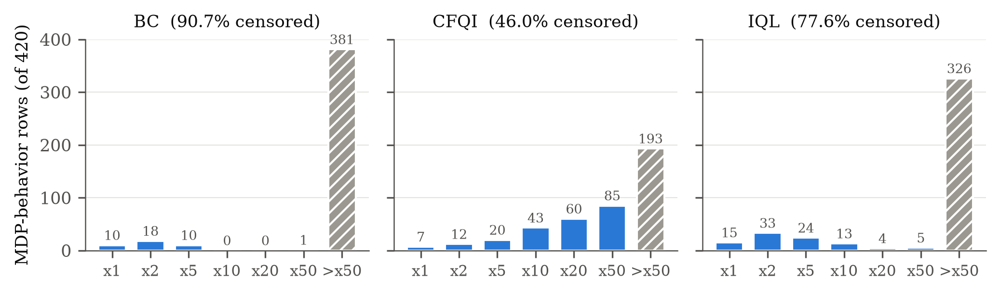

# 3. Dataset and Data Generation

## 3.1. Data Requirements and Why the Dataset Is Generated

The target of Chapter 2 places strong demands on data. To label a single row — one MDP, one behavior policy, one learner — the study needs an independent pilot, ten independent training streams long enough for the $x50$ budget, six nested prefixes of each stream, a trained policy for every prefix and seed, and the exact random and optimal returns of the MDP to compute normalized return. To *evaluate a forecaster* it then needs many such rows from many independent MDPs, so that differences between forecasters can be attributed to the method rather than to one environment, and a separate set of MDPs on which the forecaster can be fitted.

Published offline RL datasets [@fu2020] supply logs, but usually one log per task, without matched budgets, repeated training streams or exact reference returns; and their environments are usually not tabular. We therefore generate the main benchmark in a controlled way: random tabular MDP families whose kernels are known exactly, five behavior policies per MDP, and a fixed collection protocol. This makes the label exact and the comparison controlled. It also limits what the benchmark represents: the MDPs come from a small number of generator families, and real applications rarely allow exact evaluation. To probe this limit we additionally test transfer to independently published MDPs (Section 5.6), for which our group still has to generate the logs and labels.

## 3.2. Environment Families

Four generator families are used. Three are stochastic and form the primary panel; the fourth is deterministic and serves as a control.

- **Uniform Garnet.** Random MDPs in the style of Garnet generators [@archibald1995]: each state–action pair transitions to a small random set of successor states with Dirichlet-distributed probabilities, and rewards are sparse.
- **Forward-layered.** States are arranged in layers; transitions move forward through the layers, mostly along a backbone, with random branching. Rewards appear late, so good behavior requires planning several steps ahead.
- **Bottleneck.** Two communities of states are connected through a narrow bridge. Reaching the rewarding community requires passing through the bridge, which is taken with low probability by most policies.
- **Combination lock (control).** A deterministic chain with two actions; the wrong action resets to the start. It is the classic hard-exploration structure and has no transition noise.

Within each family, recipe levels are stratified by a hash-derived permutation so that every level appears in a balanced way, and a new kernel seed then samples the transitions and rewards (Table 3.1). The sealed test cohort contains 120 MDPs, $32\le|S||A|\le256$ in the stochastic families, with a total of $\sum|S||A|=9{,}676$ over all 120 MDPs.

Table: Table 3.1. MDP families and recipe levels of the sealed test cohort.
| Family | MDPs | Structure and stratified recipe levels |
|---|---:|---|
| Uniform Garnet (stochastic) | 30 | 24/32/48/64 states; 2/3/4 actions; branching 2/3/4/6; transition Dirichlet concentration 0.25/1/4; reward sparsity 0.05/0.10/0.25 |
| Forward-layered (stochastic) | 36 | depth 4/6/8/10; width 3/4/5; 2/3/4 actions; branching 2/3; concentration 0.5/1/3; backbone probability 0.9 |
| Bottleneck (stochastic) | 18 | community size 10/14/18/24; 2/3/4 actions; branching 2/3/4; bridge probability 0.20/0.35/0.50; backbone probability 0.15 |
| Combination lock (deterministic control) | 36 | length 5/7/9/12/15/18; 2 actions; wrong action resets |

Every candidate MDP must pass an ex-ante return-span filter, $J^*-J_{\mathrm{random}}\ge 0.01/(1-\gamma)=0.2$, so that normalized return is well defined. The filter reads the true MDP but no learner outcome or forecast; it rejected three bottleneck proposals and none in the other families. Six lock recipes were substituted before any outcome to avoid duplicate kernels in the small lock space. Before outcomes were generated, every kernel's fingerprint was compared with all previously opened cohorts; all 120 are new.

## 3.3. Behavior Policies and Data Collection

Each MDP is logged by five behavior policies chosen to produce different coverage and quality (Table 3.2). One parameter level is drawn per MDP from a three-level grid in a deterministic rotation, never chosen after seeing outcomes.

Table: Table 3.2. Behavior policies. $\epsilon$-soft means that a deterministic action is mixed with the uniform distribution with weight $\epsilon$.
| Behavior | Construction | Parameter grid | Uses true $Q^*$? |
|---|---|---|---|
| `q_star_softmax` | Softmax of the normalized optimal action values | temperature 0.001/0.003/0.01 | Yes, only to generate actions |
| `perturbed_reward` | $\epsilon$-soft optimal policy of an MDP with noisy rewards | noise 0.05/0.15/0.30; $\epsilon$ 0.05/0.2/0.4 | No |
| `structured_random` | $\epsilon$-soft argmax of a random low-rank score | $\epsilon$ 0.05/0.2/0.4 | No |
| `two_policy_mixture` | Mixture of the argmax and argmin of a shared random score | weight 0.25/0.5/0.75 | No |
| `shifted_dynamics` | $\epsilon$-soft optimal policy of a kernel mixed with an action-permuted kernel | shift 0.15/0.35/0.55; $\epsilon$ 0.05/0.2/0.4 | No |

The `q_star_softmax` behavior uses the optimal $Q$ values of the true MDP, but only to generate the logged actions; the forecaster sees the resulting pilot, never the values themselves. The other four behaviors vary coverage and quality without reference to the optimal policy. Data are collected in episodes of at most 100 steps that restart from $\rho$ and end early at terminal states.

## 3.4. Dataset Structure and Label Generation

Every logged transition stores the state, action, reward, next state, trajectory identifier, time step, and terminal and truncation flags. For each MDP–behavior pair the generator produces:

1. **One pilot stream** with prefixes of $x2$, $x5$ and $x10$ transitions. The $x10$ prefix is the pilot $D_0$; the smaller prefixes are used only by the legacy diagnostics of Section 4.5.
2. **Ten training streams**, each of length $x50$, with distinct seeds from a namespace disjoint from the pilot. Within a stream the six budgets are nested prefixes.

For each learner, budget and training stream, a policy is trained on the prefix and evaluated exactly in the true MDP. The core grid therefore contains $120\text{ MDPs}\times5\text{ behaviors}\times3\text{ learners}\times6\text{ budgets}\times10\text{ seeds}=108{,}000$ learner jobs. Applying Eq. (2.6) to the ten-seed success counts yields one label per MDP–behavior–learner triple: $120\times5\times3=1{,}800$ labels, of which $84\times15=1{,}260$ are in the stochastic primary panel and 540 in the control panel. A separate selection study trains four further learners at $x10$ only on the stochastic panel, adding $84\times5\times4\times10=16{,}800$ audited learner jobs.

Table: Table 3.3. Units of the sealed test cohort.
| Unit | Count | Role |
|---|---:|---|
| MDP kernels | 120 (84 stochastic + 36 control) | Independent unit of inference |
| MDP–behavior groups | 600 (420 primary) | One pilot each |
| Forecast rows (MDP–behavior–learner) | 1,800 (1,260 primary) | One seven-class label each |
| Core learner jobs | 108,000 | Train and evaluate one policy |
| Training streams | 6,000 (10 per group) | Nested budgets $x1$ to $x50$ |

## 3.5. Data Splits and Leakage Control

The forecaster is fitted on **meta-training** data: seven previously opened cohorts with 720 MDPs and 10,800 labeled rows. These cohorts were used to develop the method, so their labels are known. The **test** cohort is the 120 new kernels above. Four controls keep test information out of the forecast.

- **Separate streams.** Pilot and training streams use disjoint seed namespaces; no transition of the pilot appears in a training buffer.
- **Grouped folds.** Inside meta-training, all tuning uses five folds assigned by a hash of the MDP identifier, so that all behaviors and learners of one MDP are always in the same fold.
- **Kernel fingerprints.** Each test kernel was checked against the fingerprints of all opened cohorts. Human-readable identifiers that were reused between cohorts were disambiguated by namespacing the opened rows before outcomes.
- **Pre-outcome seal.** The protocol, every forecast and every learner choice were written and hashed while zero test outcomes existed. The 108,000 learner jobs were run only afterward, against a sealed execution plan, and the result manifest points back to the seal.

The later block ablation (Section 5.5) adds a mechanical guard: an operating-system audit hook refuses to open any outcome file of the test cohort until all of the ablation's predictions have been hashed.

## 3.6. Data Characteristics and Sources of Difficulty

The empirical requirement differs sharply across learners on identical data (Figure 3.1). On the 420 primary MDP–behavior groups, the censored class $>x50$ holds 90.71% of BC labels, 45.95% of CFQI labels and 77.62% of IQL labels; overall, 900 of 1,260 primary labels (71.43%) are censored. CFQI's finite labels are spread over the whole grid, with the mode at $x50$, whereas BC and IQL succeed, when they succeed at all, mostly at small budgets. This pattern is consistent with the learners' mechanisms: imitation succeeds only when the behavior is already near-optimal, which is visible early or not at all, while value iteration over observed actions keeps improving as more state–action pairs are covered.

{width=16}

The difficulty also depends on the behavior and the family. Censoring is lowest for `q_star_softmax` (41.3%) and highest for `two_policy_mixture` (88.5%) and `structured_random` (84.9%), with `shifted_dynamics` (69.0%) and `perturbed_reward` (73.4%) in between. Among families, bottleneck MDPs are hardest (86.3% censored) because the bridge between communities is rarely traversed, so the rewarding region is thinly covered; Garnet (66.7%) and forward-layered MDPs (68.0%) are easier. The deterministic controls are 73.5% censored.

The same environment does not have a single difficulty. In the group `oehfinal120_forward_layered_004` with behavior `q_star_softmax`, the ten-seed success counts at $x1,\ldots,x50$ are $(6,7,8,10,10,10)$ for CFQI, $(4,6,7,10,10,10)$ for IQL and $(2,3,2,2,2,1)$ for BC, giving $E_{\mathrm{CFQI}}=x5$, $E_{\mathrm{IQL}}=x10$ and $E_{\mathrm{BC}}=>x50$. This group was chosen after outcomes purely to illustrate the definition.

Two properties of the labels limit what any forecaster can achieve. First, **label noise**: in 21.0% of primary rows the success count decreases between two consecutive budgets, so the ten-seed estimate is noisy near the 8/10 threshold. Second, **class imbalance**: with 71.43% censored rows, a forecaster can obtain a low average score by predicting the censored class confidently, while the informative cases — rows with a finite requirement — are fewer. Chapter 5 therefore reports learner-specific scores, the share of error on finite rows, and the score at each budget threshold alongside the averages.
