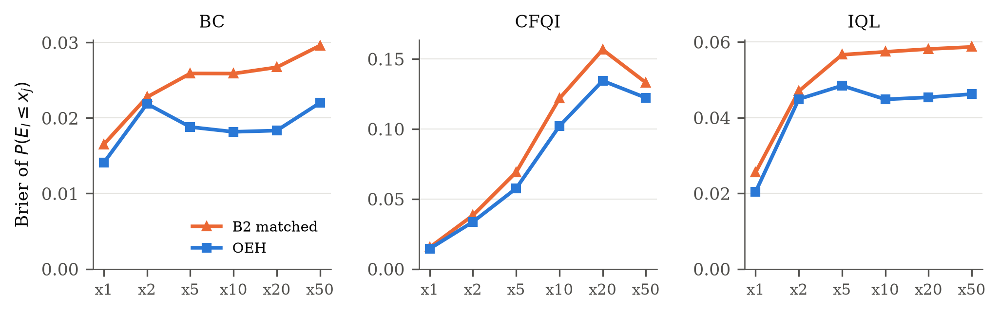
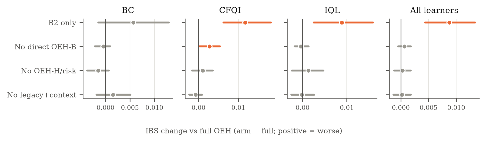

# 5. Results and Discussion

All numbers in this chapter are regenerated from sealed or completed artifacts by the manuscript export script (Appendix E). Results on the sealed test cohort are labeled **confirmatory** when they belong to the registered gates and **descriptive** or **exploratory** otherwise.

## 5.1. Requirement Forecasting Results (RQ1)

Table 5.1 reports the registered forecast comparison on the 84 stochastic MDPs. OEH lowers the integrated Brier score from 0.054727 (B2 matched) to 0.045989, a relative reduction of 15.97%, and the seven-class log loss from 0.627179 to 0.563079, a reduction of 10.22%. The simultaneous one-sided 95% lower bounds on these absolute improvements are +0.002749 and +0.029810. Every one of the 22 registered contrasts has a positive mean improvement and a positive simultaneous lower bound, so the Tier 1, Tier 2 and combined forecast gates are **GO**.

Table: Table 5.1. Sealed forecast scores on 84 stochastic MDPs (lower is better). Gain is the relative improvement of OEH over the row; LB is the simultaneous one-sided 95% lower bound on the absolute improvement over 22 registered contrasts. Control: 36 deterministic MDPs, descriptive.
| Forecaster | Tier | IBS | LL | Gain IBS / LL | LB IBS / LL | Control IBS / LL |
|---|---|---:|---:|---:|---:|---:|
| B2 matched | 1, matched | 0.054727 | 0.627179 | 15.97% / 10.22% | +0.00275 / +0.0298 | 0.02422 / 0.3085 |
| B2 + ERI adaptation | 1, matched | 0.056672 | 0.632970 | 18.85% / 11.04% | +0.00414 / +0.0337 | 0.02414 / 0.3080 |
| B2 + BWD adaptation | 1, matched | 0.053954 | 0.621165 | 14.76% / 9.35% | +0.00227 / +0.0255 | 0.02327 / 0.2942 |
| B2 generic | 1, AFT only | 0.063990 | 0.782395 | 28.13% / 28.03% | +0.01043 / +0.1463 | 0.02634 / 0.3613 |
| Coverage + quality | 1, AFT only | 0.068844 | 0.825023 | 33.20% / 31.75% | +0.01413 / +0.1747 | 0.02677 / 0.3583 |
| Train frequency | 1, no features | 0.109529 | 0.942767 | 58.01% / 40.27% | +0.04824 / +0.3141 | 0.16072 / 0.8882 |
| B2 + oracle EH | 2, privileged | 0.054712 | 0.626642 | 15.94% / 10.14% | +0.00245 / +0.0264 | 0.02431 / 0.3091 |
| B2 + TQ/SACo | 2, privileged | 0.052213 | 0.614164 | 11.92% / 8.32% | +0.00101 / +0.0228 | 0.02408 / 0.3065 |
| Published metrics only | 2, privileged | 0.062988 | 0.678562 | 26.99% / 17.02% | +0.01037 / +0.0736 | 0.02960 / 0.3307 |
| Raw OEH-B | not gated | 0.097826 | 0.910682 | — | — | 0.15784 / 0.8986 |
| Earlier OEH features | not gated | 0.050907 | 0.607922 | — | — | 0.02171 / 0.2833 |
| **OEH (108 columns)** | candidate | **0.045989** | **0.563079** | — | — | 0.02087 / 0.2857 |

Three observations qualify the headline. First, the strongest comparator is privileged: B2 plus the author-code TQ/SACo scores, which need reference datasets generated in the true MDP. OEH still improves on it (11.92% IBS, 8.32% LL), and this contrast has the smallest lower bound of all (+0.00101), but the two rows do not have equal information, so this is a stress test rather than a deployable competitor. The oracle effective horizon adds almost nothing to B2 (0.054712 versus 0.054727), which shows that a true-MDP planning statistic is not by itself what the requirement depends on. Second, the head matters: B2 fitted with the AFT component only (B2 generic) is 16.9% worse in IBS than B2 under the matched head, so comparisons across heads would mix feature and model effects; the matched rows avoid this. Third, the raw OEH-B law, used without a fitted head, is poorly calibrated (IBS 0.097826), worse than every fitted row; its value lies in being an input to the fitted model. The earlier OEH feature set is better than B2 but worse than the current set. On the 36 deterministic controls, the ordering is the same but descriptive.

BWD is listed because it belongs to the sealed gate; the group later excluded it from current method comparisons because the published distance is defined for continuous actions and our one-hot tabular version does not preserve that geometry. Excluding it after the fact would not create a new confirmatory gate, and keeping it does not change any verdict.

**Answer to RQ1.** Under the same forecasting head, meta-training data and pilot access, OEH forecasts the learner-specific censored requirement better than generic dataset statistics and better than the adapted published quality scores, with registered simultaneous bounds above zero. The result is established for new kernels of the three studied stochastic families; it is the second test in which the same OEH configuration passed Tier 1 (the fourth cohort, Section 5.6, was the first).

## 5.2. Results by Learner, Behavior and Environment Family (RQ2)

Table 5.2 decomposes the comparison of OEH with B2 matched. Intervals are MDP-clustered 95% bootstrap intervals for the mean difference; they are descriptive and not corrected for multiplicity.

Table: Table 5.2. OEH versus B2 matched by subgroup on the 84 stochastic MDPs (descriptive). Δ = OEH − B2; negative favors OEH.
| Subgroup | MDPs | Censored | IBS B2 → OEH | Δ IBS [95% interval] | LL B2 → OEH | Δ LL [95% interval] |
|---|---:|---:|---:|---:|---:|---:|
| BC | 84 | 90.7% | 0.0246 → 0.0189 | −0.0057 [−0.0133, +0.0018] | 0.2003 → 0.1772 | −0.0231 [−0.0534, +0.0082] |
| CFQI | 84 | 46.0% | 0.0891 → 0.0774 | −0.0117 [−0.0179, −0.0064] | 1.1766 → 1.0775 | −0.0992 [−0.1419, −0.0585] |
| IQL | 84 | 77.6% | 0.0506 → 0.0417 | −0.0089 [−0.0156, −0.0027] | 0.5046 → 0.4346 | −0.0700 [−0.1049, −0.0387] |
| Garnet | 30 | 66.7% | 0.0543 → 0.0380 | −0.0163 [−0.0254, −0.0082] | 0.6151 → 0.5105 | −0.1045 [−0.1508, −0.0622] |
| Forward-layered | 36 | 68.0% | 0.0722 → 0.0651 | −0.0072 [−0.0143, +0.0000] | 0.8028 → 0.7370 | −0.0658 [−0.1081, −0.0243] |
| Bottleneck | 18 | 86.3% | 0.0205 → 0.0211 | +0.0007 [−0.0021, +0.0045] | 0.2961 → 0.3029 | +0.0068 [−0.0144, +0.0259] |
| `q_star_softmax` | 84 | 41.3% | 0.1156 → 0.0960 | −0.0197 [−0.0359, −0.0033] | 1.1511 → 1.0282 | −0.1229 [−0.2044, −0.0392] |
| `perturbed_reward` | 84 | 73.4% | 0.0471 → 0.0404 | −0.0067 [−0.0134, −0.0007] | 0.6022 → 0.5379 | −0.0644 [−0.1016, −0.0285] |
| `shifted_dynamics` | 84 | 69.0% | 0.0622 → 0.0575 | −0.0047 [−0.0126, +0.0037] | 0.7356 → 0.7038 | −0.0318 [−0.0760, +0.0103] |
| `structured_random` | 84 | 84.9% | 0.0240 → 0.0178 | −0.0062 [−0.0137, −0.0006] | 0.3326 → 0.2873 | −0.0452 [−0.0795, −0.0126] |
| `two_policy_mixture` | 84 | 88.5% | 0.0247 → 0.0183 | −0.0064 [−0.0106, −0.0031] | 0.3143 → 0.2582 | −0.0562 [−0.0846, −0.0318] |

**By learner.** OEH has the lower mean score for every learner. For CFQI and IQL the intervals exclude zero on both metrics. For BC, whose labels are 90.7% censored, the relative change is the largest in IBS (−23.1%) but the interval crosses zero, because only 39 of 420 BC rows carry a finite requirement.

**By family.** The gain is largest on Garnet MDPs (−30.0% IBS), smaller on forward-layered MDPs (−9.9% IBS, with the interval just reaching zero; −8.2% LL, interval excluding zero), and absent on the 18 bottleneck MDPs, where OEH is slightly worse on both metrics (+3.3% IBS, +2.3% LL; intervals cross zero). Bottleneck MDPs are also the most censored (86.3%): the bridge between communities is rarely traversed, so the pilot contains little of the rewarding region and neither the posterior simulation nor the planning descriptor has much to work with.

**By behavior.** OEH is better on average for all five behaviors. The largest absolute gain is on the near-optimal `q_star_softmax` behavior, where finite requirements are most common, and the weakest on `shifted_dynamics`, whose behavior is optimal for a different kernel, so the logged actions are informative about the wrong MDP.

**Where the gain arises.** Figure 5.1 splits the integrated score into its six threshold terms. Both forecasters are calibrated in the large: the mean forecast probability $P(E_l\le x_j)$ is within a few hundredths of the observed attainment rate at every budget for both (calibration table in the artifacts). OEH's advantage is therefore discrimination — it separates rows that will succeed from rows that will not — and it is concentrated at $x5$–$x50$ for BC and IQL and at $x10$–$x20$ for CFQI, where the requirement is most uncertain.

{width=16}

**Where error remains.** The rows whose requirement lies inside $x1$–$x50$ are 28.57% of the primary panel but carry 73.74% of OEH's total IBS and 81.39% of its total log loss; CFQI alone carries 56.1% of the IBS. On finite rows OEH's mean IBS is 0.1187 (B2: 0.1392), on censored rows 0.0169 (B2: 0.0210). The remaining difficulty is therefore to place a finite requirement at the right budget, not to recognize the censored class. Label noise sets a floor: 21.0% of primary rows have a success count that falls between consecutive budgets, so the 8/10 rule sometimes flips on one seed.

**Answer to RQ2.** The improvement is present for all learners and behaviors on average, robust for CFQI and IQL, uncertain for BC because finite BC labels are rare, and absent for the bottleneck family. Section 5.6 shows that it is also learner-dependent on independently published environments.

## 5.3. Typical Cases and Forecast Errors

To understand the mechanism we inspected the rows with the largest log-loss differences between OEH and B2. Table 5.3 shows representative cases. The selection is post-outcome and descriptive; the explanations are hypotheses.

Table: Table 5.3. Representative rows (descriptive). $p(E)$: probability assigned to the observed class. Ceiling: posterior-mean behavior NR for BC, observed-support NR ceiling for CFQI/IQL.
| MDP / behavior / learner | Success counts $x1$…$x50$ | Label | $p(E)$ B2 → OEH | Ceiling | Reading |
|---|---|---|---|---:|---|
| Garnet 003 / shifted / CFQI | 9,10,10,10,10,10 | $x1$ | 0.016 → 0.201 | 1.00 | full support ceiling; B2 predicted censoring (0.71) |
| Forward-layered 012 / q* / BC | 8,10,10,10,10,10 | $x1$ | 0.167 → 0.766 | 0.93 | near-optimal behavior recognized |
| Garnet 001 / structured / IQL | 0,0,0,0,0,0 | $>x50$ | 0.215 → 0.964 | 0.85 | correctly confident censoring |
| Forward-layered 016 / q* / BC | 5,9,10,10,10,10 | $x2$ | 0.556 → 0.018 | 0.83 | simulated BC fails; true BC succeeds |
| Bottleneck 004 / shifted / BC | 5,6,10,10,10,10 | $x5$ | 0.199 → 0.052 | 0.33 | same pattern under low coverage |
| Forward-layered 035 / q* / BC | 1,0,0,0,0,0 | $>x50$ | 0.736 → 0.226 | 0.89 | OEH expected early BC success |

The successes follow the intended logic. When the posterior shows that the observed actions already support an optimal policy (support ceiling 1.0) and the pilot covers the rewarding region, OEH moves probability to early budgets for CFQI; when the behavior is near-optimal, it predicts early success for BC; and when neither holds, it predicts censoring with confidence. Across all rows, the ceilings separate outcomes clearly: BC rows with a finite requirement have a mean posterior-behavior ceiling of 0.90 versus 0.27 for censored BC rows, and CFQI rows with a finite requirement have a mean support ceiling of 0.97 versus 0.75 for censored ones.

The failures share a pattern. In several BC rows the true behavior was good enough for BC to succeed early, but the posterior-mean behavior has a ceiling below the 0.95 threshold, the simulated BC fails in most posterior draws, and OEH predicts censoring. A plausible cause is the behavior prior: smoothing the action counts toward uniform makes the simulated behavior worse than the true one, which hurts BC more than the value-based learners. The converse error (Forward-layered 035) occurs when the posterior overstates the behavior. Testing this hypothesis would require a pre-registered change of the behavior prior on unopened data; we did not tune it on this cohort.

## 5.4. Learner Selection at a Fixed Budget (RQ3)

The selector chose CFQI in 306, BCQ in 104 and CQL in 10 of the 420 stochastic MDP–behavior groups. Table 5.4 reports every registered rule.

Table: Table 5.4. Learner selection at $x10$ on 84 stochastic MDPs (420 groups). Higher is better.
| Rule | Mean NR | Seed success | Note |
|---|---:|---:|---|
| Fixed BC | 0.3817 | 11.83% | |
| Fixed CFQI | 0.7927 | 41.29% | registered comparator; best fixed learner |
| Fixed IQL | 0.5856 | 22.60% | |
| Fixed BCQ | 0.5756 | 39.17% | author code |
| Fixed CQL | 0.4816 | 36.14% | d3rlpy |
| Fixed SPIBB | 0.5183 | 12.17% | receives the true behavior policy |
| Fixed VI-LCB | 0.3639 | 8.90% | receives terminal metadata |
| Random choice | 0.5285 | 24.59% | |
| Internal v5 router | 0.8132 | 47.33% | earlier registered router |
| **OEH selector** | **0.8114** | **47.95%** | uses family labels |
| Outcome oracle | 0.8379 | 53.50% | upper bound, not deployable |

Against fixed CFQI, the selector improves seed success by 6.67 percentage points (simultaneous lower bound +4.26 points) and mean normalized return by 0.018656 (lower bound +0.010341); success improved in 48 MDPs and worsened in 6. The registered two-endpoint gate is **GO**. It closes about 41% of the return gap and 55% of the success gap between fixed CFQI and the outcome oracle. Against the internal v5 router, the selector differs by −0.0018 in return and +0.62 points in success; both bounds of the four-contrast family that includes v5 are negative (−0.0092 and −0.0088), so there is **no evidence of superiority over v5**.

**Answer to RQ3.** The forecasts support a selector that is better than always using the strongest single learner, but not better than an earlier router. Three qualifications apply: the selector uses the MDP-family label, which a pilot does not provide; the selection gate of this cohort compares with fixed CFQI only, whereas the fourth cohort's gate also required beating v5 and failed; and the selector itself was redesigned on the opened fourth cohort. Selection is therefore a secondary, conditional result.

## 5.5. Component Analysis and Additional Experiments

### 5.5.1. Block ablation (M1, exploratory)

The ablation of Section 4.10 was run after the column lineage had been fixed. Its full and B2 arms reproduce the sealed predictions to within $8.9\times10^{-8}$, and a re-run of every feature producer on 40 pilots reproduces the sealed feature values to within $10^{-11}$, so the arms differ only in their columns. Table 5.5 and Figure 5.2 summarize the results.

Table: Table 5.5. Block ablation on the 84 stochastic MDPs (exploratory: the cohort was opened). IBS by learner and pooled; Δ = arm − full OEH with MDP-clustered 95% intervals.
| Arm | Columns | BC | CFQI | IQL | Pooled IBS | Pooled LL | Δ pooled IBS | Δ pooled LL |
|---|---:|---:|---:|---:|---:|---:|---:|---:|
| B2 matched | 18 | 0.02456 | 0.08906 | 0.05056 | 0.05473 | 0.6272 | +0.0087 [+0.0044, +0.0134] | +0.0641 [+0.0386, +0.0904] |
| Full OEH | 108 | 0.01888 | 0.07739 | 0.04169 | **0.04599** | 0.5631 | — | — |
| Without direct OEH-B | 70 | 0.01842 | 0.08015 | 0.04135 | 0.04664 | 0.5728 | +0.0007 [−0.0005, +0.0018] | +0.0098 [+0.0016, +0.0185] |
| Without OEH-H/risk | 84 | 0.01739 | 0.07848 | 0.04303 | 0.04630 | 0.5733 | +0.0003 [−0.0012, +0.0018] | +0.0103 [−0.0019, +0.0224] |
| Without legacy + context | 80 | 0.02042 | 0.07664 | 0.04155 | 0.04620 | **0.5613** | +0.0002 [−0.0013, +0.0018] | −0.0018 [−0.0109, +0.0079] |

{width=16}

The dominant pattern is redundancy. Moving from B2 to the full set lowers the pooled IBS by 19.0% and the pooled LL by 11.4% (relative to full OEH), whereas removing any single block costs at most 1.4% in pooled IBS and 1.8% in pooled LL. No block is necessary for most of the gain; the three OEH blocks carry overlapping information about the same underlying quantities — whether the logged actions support a good policy, and how much data the learner needs to find it. A few block effects have intervals that exclude zero. Removing the direct OEH-B summaries worsens the pooled LL (+0.0098) and both CFQI scores (IBS +0.0028 [+0.0003, +0.0054]; LL +0.0271 [+0.0082, +0.0463]); the learner simulation thus carries information about CFQI that the other blocks do not fully replace. Removing OEH-H and the risk profile worsens IQL's LL (+0.0251 [+0.0053, +0.0464]) but improves BC's mean IBS (−0.0015, interval crossing zero). Removing the legacy OEH3/LCOEH4 diagnostics and their cross-learner context changes nothing detectable and improves the CFQI mean slightly; these columns appear dispensable.

These findings are exploratory and must not be used to choose a new feature set on this cohort. They do suggest the contrasts for a future confirmatory component test: B2 versus B2 plus learner simulation versus B2 plus planning descriptors versus their union, sealed on an unopened cohort.

**Cost.** Feature generation is dominated by the posterior simulation of the learner. In a sequential probe on 40 pilots (two MDPs per family, five behaviors), the median time per MDP–behavior pair was 0.003 s for B2, 0.30 s for OEH3, 0.99 s for LCOEH4, 1.2 s for the posterior fit, 2.1 s for OEH-H and 26.0 s for OEH-B; the full set needed 29.8 s per pair against 4.7 s without direct OEH-B. The probe shared the laptop CPU with another long job, so absolute times are inflated; the sealed parallel run logged a median of 10.7 s for OEH-B (9,037 s over 600 pairs). Fitting the head on 10,800 meta-training rows took 25.5 s for B2 and 86.5 s for the full set. The arm without direct OEH-B therefore cuts feature time by about 84% for a pooled loss of 1.4% IBS and 1.7% LL — a trade-off worth testing prospectively, not a change adopted here.

### 5.5.2. Other exploratory comparisons

**An adapted published survival forecaster.** The closest published statistical method we found treats censored survival as classification at discrete time points [@kim2026]. Adapted to our six thresholds with the 18 B2 statistics (XGBoost-CF/18), it scores IBS 0.0247/0.0936/0.0538 for BC/CFQI/IQL on the opened 84 MDPs, against 0.0189/0.0774/0.0417 for OEH. Fed the 108 OEH columns as an architecture control (XGBoost-CF/108), its BC IBS (0.0173) is below OEH's, while CFQI (0.0807) and IQL (0.0448) are above. The adaptation (features, budget mapping) is ours, and the comparison is post-outcome; it indicates that a strong survival head on OEH features is competitive and that part of the gain over generic features does not depend on our specific head.

**Calibration and head variants (12 October 2026).** On the opened fourth cohort, nested cross-validation compared the current forecast with temperature scaling, a blend with B2, a joint seven-class head and a two-stage head (censored versus finite, then the finite budget). Temperature scaling and the blend changed IBS by −0.58% and −0.27%, with lower bounds below zero; the joint and two-stage heads were 10.5% and 17.1% worse in IBS, and all candidates were worse than the current forecast when one MDP family was held out of the refit. These probes used 25 inputs (B2 plus the seven OEH-B probabilities), not the full 108-column set, so they test heads rather than OEH. They support keeping the frozen method and are not ablations of it.

## 5.6. Negative Results and Evaluation on Published Data

**History of the forecasting question.** The sealed cohort is not the first test. Table 5.6 lists every new 120-MDP test of the forecasting question with its own registered verdict. The first three tests used earlier OEH formulations and failed; their log-loss gains over the matched B2 control were about 4%, short of the bounds or minimum gains then required. The fourth test introduced the current configuration and passed Tier 1 but failed the privileged comparison and the selection gate. The seventh cohort repeats the fourth's configuration with one more meta-training cohort and passes all forecast gates. The repetition of Tier 1 success across two independent cohorts is the strongest evidence for the forecasting claim; the earlier failures show that it was not obtained on the first attempt.

Table: Table 5.6. New 120-MDP tests of the forecasting question (84 stochastic MDPs each; matched B2 control of that cohort).
| Test | OEH IBS / LL | B2 IBS / LL | Gain IBS / LL | Registered verdict |
|---|---:|---:|---:|---|
| 1st | 0.05920 / 0.6719 | 0.06625 / 0.7007 | 10.6% / 4.1% | NO-GO |
| 2nd | 0.06014 / 0.6691 | 0.06609 / 0.6978 | 9.0% / 4.1% | NO-GO |
| 3rd | 0.05818 / 0.6356 | 0.06322 / 0.6645 | 8.0% / 4.4% | NO-GO |
| 4th | 0.05291 / 0.6427 | 0.06242 / 0.6996 | 15.2% / 8.1% | Tier 1 GO; Tier 2, combined, selection NO-GO |
| 7th (this thesis) | 0.04599 / 0.5631 | 0.05473 / 0.6272 | 16.0% / 10.2% | Tier 1, Tier 2, combined GO; selection GO vs CFQI, not vs v5 |

**Published offline dataset (FourRooms).** The Farama Minari `D4RL/minigrid/fourrooms-random-v0` dataset [@fourrooms] is an independently published offline log, but its observations are partial visual views, so the full tabular forecaster cannot be applied. A pre-registered test evaluated only the Dirichlet transition component: on a fixed split (990 training episodes, 2,084 test episodes, 7,100 unused), it predicts the next local object category. The empirical-Bayes component scored Brier 0.03492 and log loss 0.08801. It beat Krichevsky–Trofimov smoothing (Brier 0.05417; both simultaneous bounds positive) but not maximum likelihood (Brier 0.02972; Brier difference −0.00520 with lower bound −0.00648; log-loss bound −0.00950). The four-contrast gate is **NO-GO**. The fitted concentration was very small (0.020); one possible reading is that the prior smoothed contexts where the counts alone were already informative, but the test was not designed to establish the cause.

**Published MDPs (BRIDGE).** BRIDGE publishes tabular versions of Atari, MiniGrid and Procgen environments [@laidlaw2024; @bridge2024]. The MDPs are independent of our generators, but the offline pilots and requirement labels were generated by our group with the same endpoint, BC/CFQI/IQL, five behaviors, ten seeds and six budgets. The transfer protocol differs from the internal one: 25% sticky actions with the previous action in the state, the published task horizons, rewards scaled by the task's maximum, and $\gamma=0.99$. Forecasters were fitted on the internal meta-training cohorts, and their predictions were sealed before labels. Table 5.7 reports the three completed panels.

Table: Table 5.7. Transfer to published BRIDGE MDPs. Δ IBS = OEH − B2 with descriptive task-clustered 95% intervals (negative favors OEH). XGBoost-CF/18 is the adapted survival forecaster.
| Panel (tasks, rows per learner) | Learner | Censored | B2 IBS | XGBoost-CF/18 IBS | OEH IBS | Δ IBS [95% interval] |
|---|---|---:|---:|---:|---:|---:|
| Atari, full OEH (5, 25) | BC | 92% | 0.0599 | 0.0456 | 0.0282 | −0.032 [−0.083, +0.009] |
| | CFQI | 48% | 0.2968 | 0.2920 | 0.2841 | −0.013 [−0.071, +0.036] |
| | IQL | 84% | 0.0498 | 0.0712 | 0.1128 | +0.063 [+0.004, +0.139] |
| Expanded, full OEH (5, 25) | BC | 92% | 0.0455 | 0.0371 | 0.0564 | +0.011 [−0.018, +0.041] |
| | CFQI | 40% | 0.2849 | 0.2663 | 0.1533 | −0.132 [−0.269, −0.019] |
| | IQL | 92% | 0.0747 | 0.0743 | 0.0710 | −0.004 [−0.031, +0.024] |
| MiniGrid, reduced OEH (14, 70) | BC | 90% | 0.0224 | — | 0.0445 | +0.022 [+0.007, +0.038] |
| | CFQI | 60% | 0.1557 | — | 0.0819 | −0.074 [−0.097, −0.049] |
| | IQL | 87% | 0.0253 | — | 0.0152 | −0.010 [−0.018, −0.002] |

The transfer result is **mixed and learner-dependent**. CFQI is the consistent beneficiary: OEH has the lowest CFQI Brier score on the expanded panel, with an interval excluding zero against B2 and against XGBoost-CF/18, and the reduced arm also helps CFQI on MiniGrid. IQL is clearly worse on the Atari panel, and BC is worse on the expanded and MiniGrid panels. With five tasks per full panel, intervals are wide, and they are not corrected for multiplicity. The 14-task MiniGrid panel tested only the reduced arm without direct OEH-B; a full-OEH reanalysis of those tasks was still running when this thesis was compiled and, because their labels were already opened, would be exploratory. In one Atari group and four expanded-panel groups the posterior returned no valid draw and OEH-B used its censored fallback.

**Lessons.** Three conclusions follow. The forecasting gain does not automatically transfer across environment families, which is why the claim of this thesis is restricted to the studied families. The learner whose requirement depends most on coverage (CFQI) benefits most consistently from the pilot model, while learners whose success depends on behavior quality or exploration of rare actions do not. And components that look good in development can fail on independently published data (FourRooms), so each transfer must be tested rather than assumed.

## 5.7. Cost, Reproducibility and Limitations

**Cost.** The pilot itself costs $x10$ transitions. OEH's feature generation costs seconds to minutes per MDP–behavior pair on the internal panel (Section 5.5.1) and grows quickly with $|S||A|$: the five-task Atari panel required 9.31 summed group-hours for OEH-B alone. The label grid is much more expensive than either: 108,000 learner jobs per cohort. We have not measured a decision protocol — choose a budget from the forecast, collect that much data, train — so we make **no claim of data or compute savings**. Forecasts of the $x1$–$x5$ classes are retrospective because the pilot already holds $x10$ transitions.

**Reproducibility.** The protocol, pre-outcome seal, predictions, labels, scores and contrasts of the test cohort are stored with SHA-256 hashes, and the M1 ablation records the hash of every input and source file it read. The analyses in this chapter are regenerated by one export script. Raw pilot buffers and the individual learner-job records are kept locally; a public clone verifies the published artifacts but cannot rerun all jobs. Four historical artifacts and two dataset seals of early cohorts are missing from the restored runtime, so an end-to-end reproduction from raw data has not been completed.

**Limitations.**

- **Benchmark scope.** Generated tabular MDPs from three stochastic families, exact evaluation and known state and action sets are favorable conditions; real problems have unknown dynamics, function approximation and nonstationarity.
- **Target design.** The label depends on the 0.95 threshold, ten seeds, the 8/10 sustained rule, a six-point grid and the specific learner implementations; it identifies an interval of budgets, not an exact sample size, and is noisy near the threshold.
- **Unobserved actions.** The posterior assigns zero reward to unobserved keys and smooths the behavior; Section 5.3 shows that the smoothing can mislead BC forecasts. No pilot-only method can identify unlogged actions.
- **Attribution.** The block ablation is exploratory and shows redundancy; there is no confirmatory evidence that any single component is necessary.
- **Repeated testing.** The question was tested five times on new cohorts; each gate controls error within its cohort only.
- **Transfer.** Full-method transfer to independently designed environments is learner-dependent and based on ten tasks.
- **Selection.** The selector uses family labels and does not beat the earlier router.
