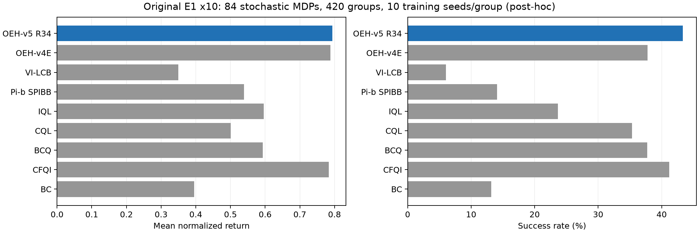
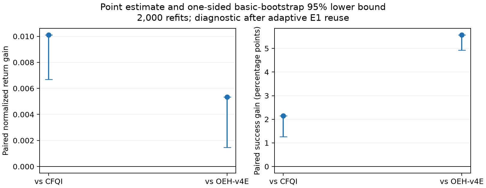

# OEH-v5 R34 — đối chiếu hậu nghiệm trên E1 gốc

Ứng viên R34 đạt normalized return **0,793480** và success **43,33%** trên
84 stochastic MDP x10: tăng cả hai chỉ số so với CFQI và OEH-v4E. Đủ 2.000
MDP-cluster bootstrap refit; cả bốn effect và cận dưới one-sided đều dương.
Đây là kết quả phát triển hậu nghiệm trên E1 đã tiêu thụ, chưa phải xác nhận
độc lập hoặc bằng chứng vượt trội trên mọi MDP. R1/R2 vẫn chờ người review.

## Dữ liệu, cấu hình và phạm vi

Dùng đúng manifest/buffer identity/policy outcome của E1 đã chạy: **120 MDP
gốc**, gồm 84 stochastic primary và 36 deterministic control. Không sinh
MDP, buffer, namespace seed mới; không chạy lại one-shot E1 hoặc train lại
baseline. So sánh ở x10, gamma 0,95, horizon 100, năm behavior và mười
training seed, giữ nguyên cấu hình learner, normalization và outer fold E1.
600 nhóm MDP–behavior, 6.000 outcome được giữ đủ; primary có 420 nhóm,
4.200 outcome. Loader đối chiếu 108.000 core result và 36.000 training
identity của grid E1 trước lấy x10.

Manifest dữ liệu gốc SHA-256:
`1b93d48cde5a5ab69a7d3a365e01583807df2876812ee338bd62227c260ec2de`.
[Manifest xuất bản](../../artifacts/week7/oeh_v5_e1_reuse_r34_2026-09-29/manifest.json)
ghi 17 hash đầu vào, source hash, runtime và hash từng artifact. Lựa chọn
learner/dự báo được niêm phong trước chấm outer test; bản sao raw giữ nguyên
byte. Đã tái lập đúng toàn bộ 600 lựa chọn OEH-v4E gốc trước so sánh điểm.
Kiểm hash ở đây áp dụng cho manifest, bảng kết quả và feature đã dùng; không
đọc lại toàn bộ byte NPZ training buffer vì không train learner mới.

## Thuật toán đã sửa gì

[Implementation](../../code/oeh_interaction_gains.py) và
[protocol khóa trước chạy](../protocol/OEH_INTERACTION_GAINS_R34_2026-09-29.json)
giữ các feature block và ridge grid T1. Thay vì dự báo absolute mean return
rồi argmax như v4E, R34 học **paired gain so với CFQI**: mean Δreturn cùng
xác suất win/loss/tie của success trên mười seed khớp nhau. Δsuccess dự báo
là p(win)−p(loss). Hai endpoint chọn ridge riêng bằng grouped inner 4-fold;
return dùng MSE, success dùng frequency loss tương đương categorical Brier
cho lựa chọn ridge, khác một hằng số theo label. Không báo loss này là
absolute per-seed Brier.

Dùng toàn bộ interaction bậc hai của feature chuẩn hóa training-only:
`K(x,z)=(1+xᵀz/d)²`, degree 2, offset 1, gamma 1/d đã khai báo trước đọc
kết quả. Không chọn interaction theo family, không sweep degree/bandwidth.
Weighted kernel centering để intercept không bị phạt; hai feature block
gốc ensemble đều trọng số. Inner CV chỉ đọc label của outer training MDP;
grouping giữ toàn bộ behavior/seed của MDP cùng phía split.

Router xét các lựa chọn deterministic trên supported frontier của
Δreturn+λΔsuccess và chọn tích aggregate Δreturn×Δsuccess lớn nhất khi cả
hai gain dự báo dương, fallback CFQI nếu không có kế hoạch như vậy. λ suy
ra từ giao điểm dự báo, không fit theo outer score và không đặt trọng số
endpoint thủ công. Một learner được dùng cho toàn bộ mười seed của nhóm.
Đây là tối ưu trên các route đã xét, không chứng minh optimum nguyên toàn
cục hoặc true no-harm. Router dùng cả batch feature của outer fold; quyết
định có thể phụ thuộc phân bố feature của batch, chưa kiểm chứng triển khai
online từng task. Target meta-training dùng performance label của thư viện
training MDP; inference trên test dùng pilot feature, không dùng oracle
test dynamics/return để chọn route.

## Chỉ số và kết quả

Normalized return dùng đúng E1: `(J_policy−J_random)/(J_star−J_random)`,
không clip. J là value được evaluator gốc tính cho policy trong MDP thật.
Success là **tỷ lệ training seed có normalized return ≥0,95**, không phải
tỷ lệ episode tới đích. Trung bình mười seed, năm behavior rồi các MDP có
trọng số bằng nhau; paired effect luôn trừ comparator trên cùng identity.

| Method trên 84 stochastic MDP x10 | Mean normalized return | Success rate |
|---|---:|---:|
| **OEH-v5 R34** | **0,793480** | **43,33%** |
| OEH-v4E | 0,788130 | 37,76% |
| CFQI | 0,783373 | 41,19% |
| IQL | 0,596383 | 23,67% |
| BC | 0,395725 | 13,17% |
| BCQ, author implementation | 0,593253 | 37,71% |
| CQL, pinned d3rlpy | 0,500659 | 35,33% |
| Pi-b SPIBB n10, author implementation | 0,539000 | 14,07% |
| VI-LCB cb0,005, empirical paper-spec port | 0,349882 | 6,05% |

R34 đứng đầu hai mean endpoint trong chín method của bảng này. Kiểm tra
paired gate chỉ áp dụng với CFQI và v4E; các baseline ngoài họ confirmatory
gốc là đối chiếu mô tả, không suy rộng thành claim SOTA.

| Paired effect R34 trừ comparator | Điểm | Cận dưới basic one-sided 95% |
|---|---:|---:|
| Return − CFQI | +0,010107 | +0,006701 |
| Success − CFQI | +2,14 điểm % | +1,26 điểm % |
| Return − OEH-v4E | +0,005350 | +0,001468 |
| Success − OEH-v4E | +5,57 điểm % | +4,93 điểm % |

2.000 draw resample whole MDP trong strata gốc, PCG64 seed 20260921, outer
fold cố định; mỗi draw fit lại cả R34 và v4E, bao gồm grouped inner ridge
selection, không chỉ bootstrap bảng prediction cố định. Thiết kế strata
khớp S1, nhưng thứ tự strata không giống thứ tự first-seen của S1 nên không
claim dùng đúng từng multiplicity vector S1. Screen nội bộ yêu cầu bốn
point effect và bốn cận dưới one-sided >0, alpha 0,05, không practical margin.
Không thay gate S1 gốc dùng margin 0,005/Holm/two-sided hoặc đổi kết luận
NO_GO confirmatory của v4E. Bootstrap xấp xỉ và reuse thích nghi không bảo
đảm error rate của một nghiên cứu confirmatory.

36 deterministic control chọn CFQI ở cả 180 nhóm: R34=CFQI, return
0,428267, success 45,22%; v4E 0,419375 và 42,06%. Hai panel fit riêng theo
thiết kế E1; control này không phải transfer/OOD validation. Trung bình mô
tả cả 120 MDP của R34: return 0,683917, success 43,90%; chưa chạy gate CI
cho aggregate 120 và không gộp controls vào primary inference.

## Vì sao kết quả cải thiện, và còn mất ở đâu

v4E chọn CFQI/IQL/BC lần lượt 340/55/25 nhóm primary; R34 chọn 361/54/5.
Số IQL gần bằng nhau nhưng identity được đổi đáng kể: 36 nhóm IQL→CFQI,
15 CFQI→IQL, 21 BC→IQL và 2 BC→CFQI. BC giảm, song hiệu quả không thể
giải thích chỉ bằng tăng CFQI hoặc giảm IQL.

Đóng góp vào Δreturn so v4E: CFQI→IQL +0,003359; BC→IQL +0,001739;
BC→CFQI +0,000307. IQL→CFQI hơi giảm return (−0,000034) nhưng tăng success
2,57 điểm %, minh họa tradeoff mean/tail mà v4E chưa tối ưu trực tiếp.
BC→IQL tăng success 1,50 điểm %, CFQI→IQL tăng 1,10 điểm %. Các chuyển
đổi còn lại, kể cả chuyển đổi âm, có trong CSV. Đây là phân rã outcome quan
sát, không cô lập tác động nhân quả riêng của kernel, target hoặc router;
chưa có ablation xác nhận từng thành phần.

So CFQI, success thắng ở 157 seed outcome, mất ở 67, tăng ròng **90/4.200**.
So v4E: thắng 271, mất 37, tăng ròng **234/4.200**. Theo mean từng MDP:

| Contrast | MDP dương | MDP âm | MDP bằng |
|---|---:|---:|---:|
| Return − CFQI | 28 | 7 | 49 |
| Success − CFQI | 22 | 10 | 52 |
| Return − v4E | 30 | 14 | 40 |
| Success − v4E | 31 | 6 | 47 |

Không lọc các trường hợp âm khỏi artifact của lần đạt. Cải thiện aggregate
không đồng nghĩa strict-improve từng MDP; empirical support chưa đủ nhận
dạng dynamics vẫn có thể làm dự báo và route sai.

## Kiểm chứng, chi phí và giới hạn công bố

Runtime scientific run **756,42 giây (~12,6 phút)**, CPU 18 worker. Đây là
fit router và bootstrap trên outcome E1 sẵn có, không phải thời gian train
baseline hoặc latency inference policy. So với fixed CFQI, R34 cần thư viện
label training MDP, pilot feature và compute meta-learning bổ sung; cùng
policy-evaluation config không có nghĩa cùng ngân sách thông tin/compute.

Full suite local: **872 test + 355 subtest, không skip**, coverage vượt 82%;
compile và smoke 14 fixture × năm behavior pass. Test kiểm weighted kernel
so với primal ridge độc lập, repeated-row equivalence, shift/feature-order
invariance, null control, categorical targets, scale invariance của joint
objective, nhãn outer test không đổi route; adapter v4E khớp pipeline gốc.
[Hồ sơ local](LOCAL_VALIDATION_2026-09-29.json) ghi kết quả kiểm tra. CI push
và PR trên GitHub Ubuntu đã pass cùng 872 test, 355 subtest, coverage 83%,
smoke 14/14 × năm behavior; [hồ sơ remote](REMOTE_VALIDATION_2026-09-29.json)
ghi SHA đã kiểm. [PR #44](https://github.com/LinhLe5118/Devoted/pull/44)
theo dõi checks của head mới nhất và chờ review. Paper nguồn cũ build được 13 trang;
[ghi chú build](PAPER_BUILD_2026-09-29.md). Chưa sửa H1-frozen source để nhét
kết quả mới vào paper trước review.

Các hướng không đạt đã bị xóa theo yêu cầu; chỉ còn
[attempt/hash ledger](../reassessment/withdrawal_ledger/). Đã có phát triển
thích nghi nhiều lần trên dữ liệu đã đọc; số administrative attempt ID không
phải số nghiên cứu độc lập hoàn chỉnh. Không che trạng thái tiêu thụ, không
gọi cross-fitting là holdout mới, không claim không tune theo benchmark ở
cấp lựa chọn hướng nghiên cứu. Implementation không có rule theo family,
ID hoặc outer label, nhưng sự khái quát ngoài cohort chưa được chứng minh.

Nguồn kiểm tra: [comparison CSV](../../artifacts/week7/oeh_v5_e1_reuse_r34_2026-09-29/comparison_x10.csv),
[MDP CSV](../../artifacts/week7/oeh_v5_e1_reuse_r34_2026-09-29/mdp_metrics.csv),
[6.000 seed outcome](../../artifacts/week7/oeh_v5_e1_reuse_r34_2026-09-29/selected_seed_outcomes.csv),
[phân rã cơ chế](../../artifacts/week7/oeh_v5_e1_reuse_r34_2026-09-29/mechanism_audit.json),
[raw report](../../artifacts/week7/oeh_v5_e1_reuse_r34_2026-09-29/raw/report.json)
và [quy tắc reuse](../protocol/E1_REUSE_COMPARISON.md).
