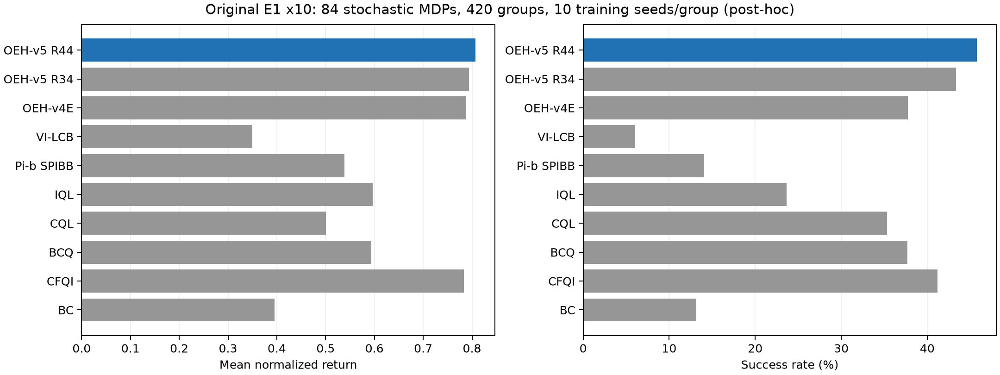
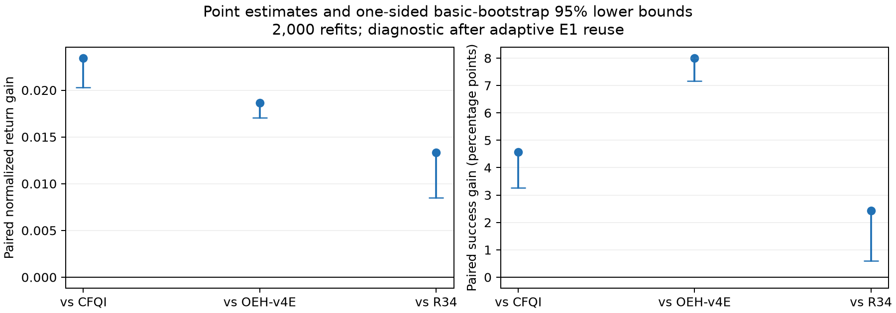

# OEH-v5 R44 — mở rộng thư viện learner trên E1 gốc

R44 đạt normalized return **0,806803** và success **45,76%** trên 84 stochastic
MDP x10, tăng cả hai endpoint so với **CFQI, OEH-v4E và R34**. Đủ 2.000
MDP-cluster bootstrap refit; cả sáu point effect và cận dưới basic one-sided
95% đều dương. Đây là kết quả phát triển hậu nghiệm trên E1 đã tiêu thụ, chưa
phải xác nhận độc lập, chứng minh khái quát ngoài cohort hoặc vượt mọi MDP.
R1/R2 vẫn chờ người review.

## Cấu hình và dữ liệu giữ nguyên

Dùng đúng **120 base MDP E1**, gồm 84 stochastic primary và 36 deterministic
control; không tạo MDP, buffer hay namespace seed mới. Giữ x10, gamma 0,95,
horizon 100, năm behavior, mười training seed 0–9, normalization, learner
configuration và outer fold gốc. Không gọi lại one-shot E1 hoặc train lại
baseline; chỉ fit meta router trên policy outcome và pilot feature có sẵn.

Manifest E1 SHA-256:
`1b93d48cde5a5ab69a7d3a365e01583807df2876812ee338bd62227c260ec2de`.
[Manifest xuất bản](../../artifacts/week7/oeh_v5_e1_reuse_r44_2026-09-29/manifest.json)
ghi source/input/artifact hash, môi trường và runtime. Runner kiểm tra 19
scientific source cùng 22 artifact R34 và đầu vào E1 trước/sau chạy. Mọi quyết
định được niêm phong trước đọc điểm outer test. Đủ 600 nhóm và 6.000 outcome
được chọn; primary có 420 nhóm/4.200 outcome. Bốn learner bổ sung có đủ 24.000
outcome E1 x10, khớp training-buffer identity; không lọc method, seed hoặc
outcome âm. Hash kiểm tra các file đầu vào đã dùng và buffer identity; không
đọc lại toàn bộ byte NPZ buffer vì không train policy mới.

## Sửa giới hạn của R34

[R34](OEH_V5_POSTHOC_REPORT_2026-09-29.md) chỉ định tuyến giữa CFQI/IQL/BC.
Ngay cả khi ba dự báo chính xác, router này không thể chọn một policy BCQ,
CQL, Pi-b SPIBB hoặc VI-LCB có lợi hơn trên một nhóm. R44 bổ sung **toàn bộ
bốn learner đã được E1 đánh giá**, lấy tên từ registry có sẵn, không chọn thư
viện bằng điểm test. Đây là thay đổi tập policy có thể chọn, không thay policy
hoặc điều chỉnh cấu hình baseline sau khi xem kết quả.

[Implementation](../../code/oeh_library_gains.py) giữ **nguyên dự báo ba core
learner của R34**. Bốn head mới học cùng paired target so CFQI: mean Δreturn
và tần suất win/loss/tie của success trên mười seed khớp nhau. Dự báo Δsuccess
là p(win)−p(loss). Vì E1 không có pilot riêng cho bốn learner này, mỗi head
dùng toàn bộ diagnostic của ba core pilot trong từng feature block gốc.
Không thêm environment ID, family rule, oracle dynamics hoặc outer-test label.

Kernel quadratic, standardization/centering có trọng số training-only,
ridge grid T1, grouped inner 4-fold, endpoint loss và equal-weight ensemble
hai feature block đều giữ R34. Chỉ inner training label chọn ridge; toàn bộ
behavior của một MDP ở cùng phía split. Router cũ tối ưu tích aggregate
predicted Δreturn × Δsuccess trên supported deterministic frontier, fallback
CFQI khi không có kế hoạch tăng cả hai endpoint dự báo. Không sweep threshold,
endpoint weight hoặc library subset; không thêm calibration/margin. Một route
dùng chung cho mười training seed của nhóm.

Tính khái quát của cơ chế là dùng observable diagnostic và paired supervision
thay vì rule cho từng môi trường. Nó vẫn cần thư viện training MDP có performance
label, pilot của ba learner neo và một batch feature để ra quyết định. Chưa
chứng minh transfer/OOD, online từng task, true no-harm hoặc optimum nguyên
toàn cục. Hướng nghiên cứu đã được lựa chọn thích nghi sau nhiều lần đọc E1;
cross-fitting không xóa sự phụ thuộc đó hoặc tạo holdout mới.

## Metrics và kết quả

Normalized return giữ công thức E1 `(J_policy−J_random)/(J_star−J_random)`,
**không clip**; J là value evaluator gốc tính trong MDP thật. Success là tỷ
lệ **training seed có normalized return ≥0,95**, không phải tỷ lệ episode
đến đích. Trung bình mười seed, năm behavior rồi các MDP với trọng số bằng
nhau. Paired effect trừ comparator trên cùng MDP/behavior/seed identity.

| Method — stochastic x10 | Mean normalized return | Success rate |
|---|---:|---:|
| **OEH-v5 R44** | **0,806803** | **45,76%** |
| OEH-v5 R34 | 0,793480 | 43,33% |
| OEH-v4E | 0,788130 | 37,76% |
| CFQI | 0,783373 | 41,19% |
| IQL | 0,596383 | 23,67% |
| BC | 0,395725 | 13,17% |
| BCQ, author implementation | 0,593253 | 37,71% |
| CQL, pinned d3rlpy | 0,500659 | 35,33% |
| Pi-b SPIBB n10, author implementation | 0,539000 | 14,07% |
| VI-LCB cb0,005, empirical paper-spec port | 0,349882 | 6,05% |

R44 đứng đầu hai mean endpoint trong mười dòng trên. Gate paired chỉ kiểm
CFQI/v4E/R34; các baseline còn lại là so sánh mô tả, không suy thành claim SOTA.

| R44 trừ comparator | Point effect | Cận dưới basic one-sided 95% |
|---|---:|---:|
| Return − CFQI | +0,023429 | +0,020306 |
| Success − CFQI | +4,57 điểm % | +3,26 điểm % |
| Return − OEH-v4E | +0,018672 | +0,017056 |
| Success − OEH-v4E | +8,00 điểm % | +7,17 điểm % |
| Return − R34 | +0,013322 | +0,008522 |
| Success − R34 | +2,43 điểm % | +0,60 điểm % |

[Protocol khóa trước chạy](../protocol/OEH_LIBRARY_GAINS_R44_2026-09-29.json)
yêu cầu cả sáu point effect >0, rồi cả sáu cận dưới >0, alpha 0,05 và không
practical margin. 2.000 draw resample whole MDP trong strata gốc, PCG64 seed
20260921; mỗi draw **fit lại R44, R34 và v4E** trên cùng multiplicity, bao gồm
inner ridge selection; outer fold cố định. Lịch draw giống study R34, không
claim đúng từng vector bootstrap S1. Cận dưới là `2×observed−q95(bootstrap)`.
Không reroll, bỏ draw hoặc đổi gate sau scoring. Sáu cận dưới này là screen
hậu nghiệm xấp xỉ; không phải simultaneous confidence region hoặc kiểm định
confirmatory được hiệu chỉnh cho các vòng lựa chọn phương pháp thích nghi.
Không thay margin/Holm/verdict NO_GO của S1 gốc.

36 deterministic control chọn CFQI ở cả 180 nhóm: R44=R34=CFQI, return
0,428267 và success 45,22%; v4E là 0,419375/42,06%. Hai panel fit riêng;
control không phải transfer validation. Mean mô tả cả 120 MDP của R44 là
return **0,693242**, success **45,60%**; không chạy gate cho aggregate 120
hoặc gộp control vào primary inference.

## Vì sao vượt R34 và giới hạn còn lại

116/420 primary route đổi so R34. R44 chọn CFQI 291, BCQ 59, CQL 48, IQL 15,
VI-LCB 5, Pi-b SPIBB 2 và BC 0 nhóm; BC vẫn trong thư viện. So R34, các nhóm
chọn BCQ đóng góp Δreturn **+0,005277** và Δsuccess **+1,67 điểm %** vào mean
toàn primary; CQL đóng góp **+0,005224/+0,76 điểm %**; VI-LCB đóng góp
**+0,002866/0**. Các chuyển đổi còn lại gồm cả phần return âm, lưu đầy đủ
trong group CSV. Đây là phân rã outcome quan sát, không chứng minh tác động
nhân quả riêng của từng diagnostic hoặc head. Mean toàn cohort của BCQ/CQL
thấp hơn CFQI vẫn có thể đi cùng lợi ích trên nhóm được router chọn.

Success so R34 thắng 181 seed outcome, mất 79, tăng ròng **102/4.200**.
So CFQI: 308 thắng/116 mất, ròng 192; so v4E: 379 thắng/43 mất, ròng 336.

| Contrast theo mean từng MDP primary | Dương | Âm | Bằng |
|---|---:|---:|---:|
| Return − R34 | 50 | 7 | 27 |
| Success − R34 | 26 | 11 | 47 |
| Return − CFQI | 51 | 9 | 24 |
| Success − CFQI | 40 | 11 | 33 |
| Return − v4E | 54 | 5 | 25 |
| Success − v4E | 43 | 3 | 38 |

Giữ toàn bộ MDP âm trong artifact của lần đạt. Vượt mean/gate không đồng
nghĩa thắng từng MDP hoặc nhận dạng được successor chưa quan sát.

## Kiểm chứng, compute và phát hành

Scientific runtime **715,02 giây (~11,9 phút)**, CPU 18 worker; đây là meta
fit/bootstrap trên outcome có sẵn, không phải thời gian train bảy baseline
hay latency policy. R44 cần thêm bốn head và performance label của thư viện
bảy learner. Cùng evaluation/learner config không đồng nghĩa bằng nhau về
tổng information/compute budget với một fixed learner.

Full suite local: **887 test + 357 subtest pass, không skip**, branch coverage
**82,9151% ≥82%**; hai test đối chiếu artifact xuất bản cũng pass; compile
và smoke 14 fixture × năm behavior pass.
[Hồ sơ kiểm chứng](LOCAL_VALIDATION_R44_2026-09-29.json) ghi scope và source
hash. Tests kiểm core forecast khớp R34, label outer test không đổi route
của chính fold, strict method/seed/buffer pairing, thư viện mở rộng được
score ở cả point và từng bootstrap, đủ 6.006 fit trong fixture toàn runner,
niêm phong trước chấm và withdrawal khi thiếu/âm/lỗi. Export kiểm lại hash,
đủ grid và tính lại sáu effect/cận dưới; không refit. PNG/PDF khớp CSV/raw.

CI checkout không chứa 17 đầu vào E1 thô cục bộ (CSV gốc và manifest khoảng
174 MB). Full input/seed audit đã chạy tại máy trước công bố; hồ sơ ghi hash
của phiên bản test tại lần chạy đó. Kiểm tra trên GitHub đọc **gói công bố**:
source/raw hash, bootstrap đầy đủ, input-hash record khớp R34, cùng identity
và outcome tham chiếu của 6.000 seed trong artifact R34, rồi gộp độc lập bảng.
Không skip test hoặc giả vờ đọc CSV/manifest E1 không có trong checkout. Lần
CI đầu phát hiện đúng hai file-scope checks thiếu đầu vào; 887 test còn lại
pass. Đã sửa phạm vi kiểm tra công bố; source/config/kết quả scientific R44
không thay đổi, không chạy lại nghiên cứu. Không upload archive đầu vào thô
sau khi kiểm duyệt tự động từ chối payload chưa được ủy quyền gửi cụ thể.

[PR #44 linh→main](https://github.com/LinhLe5118/Devoted/pull/44) theo dõi CI
cho đúng head và chờ ít nhất một reviewer theo CONTRIBUTING. R1/R2 chưa ký;
không tự nghiệm thu thay người review. H1-frozen paper/README giữ nguyên;
paper build 13 trang đã ghi ở [hồ sơ build](PAPER_BUILD_2026-09-29.md).
Kết quả R44 chưa được tích hợp vào paper trước review. R34 là benchmark
thành công được giữ nguyên; các prototype/artifact không đạt đã rút, chỉ
còn [attempt/hash ledger](../reassessment/withdrawal_ledger/). Việc rút các
thử không tạo confirmation mới hoặc khắc phục selection bias.

Nguồn: [comparison CSV](../../artifacts/week7/oeh_v5_e1_reuse_r44_2026-09-29/comparison_x10.csv),
[120 MDP](../../artifacts/week7/oeh_v5_e1_reuse_r44_2026-09-29/mdp_metrics.csv),
[600 nhóm](../../artifacts/week7/oeh_v5_e1_reuse_r44_2026-09-29/group_metrics.csv),
[6.000 seed outcome](../../artifacts/week7/oeh_v5_e1_reuse_r44_2026-09-29/selected_seed_outcomes.csv),
[mechanism audit](../../artifacts/week7/oeh_v5_e1_reuse_r44_2026-09-29/mechanism_audit.json),
[raw report](../../artifacts/week7/oeh_v5_e1_reuse_r44_2026-09-29/raw/report.json).
